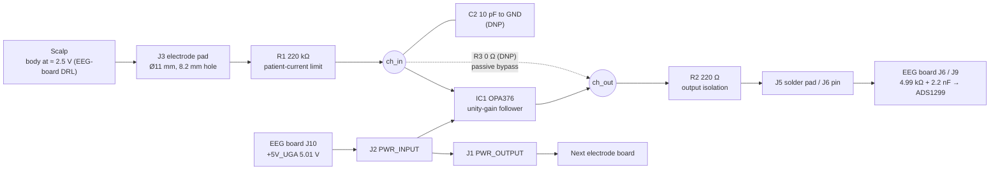

# Design Solution Definition: `Active Electrode Buffer Board (AEB-1)`

> **Project:** `N-pulse – Wearable EEG System for Prosthetic Control`
> **Document ID:** `DSD-EEG-BUFFER-BOARD-001`
> **Version:** `0.1.0` · **Status:** `Draft`
> **Project phase:** `Prototype` (board rev 1.0: schematic and layout finished, not yet fabricated)
> **Last modified:** `2026-10-25`
> **Repository path:** `Docs/DSD-BUFFER-BOARD.md`, repository `github.com/N-Pulse/EEG-HW-System`, branch `feature/decoding_board`

<!--
HOW TO USE THIS TEMPLATE
- Replace every `<placeholder>`. Delete guidance comments before review.
- One DSD per subsystem or module
- The DSD must stand alone: a reviewer should be able to judge the design
  from this document, the linked requirements, and the linked evidence.
- Normative language: "shall" = requirement, "should" = recommendation,
  "may" = optional.

Items still to be completed by the author are marked **[TO COMPLETE]**.
-->

---

## Document control

### Roles and sign-off

| Role | Name | Affiliation / Handle | Date | Signature / Review link |
|---|---|---|---|---|
| Author(s) | Julian Rodriguez | EEG Board Designer / @Julian-R-R | 2026-10-25 | |
| Reviewer (technical) | Maëlys Clerget | N-pulse — EEG Team Leader | @maelysclerget | | |
| Concurrence (SE Reviewer) | Luca Seelbach | N-pulse — System Engineer Electronics | | |
| Concurrence (Quality management reviewer) | Armelle Chritin | N-pulse — Quality Management | | |
| Approval (Project Manager) | Elodie Dubois | N-pulse — Project Manager | | |

> Note : Link approval to any relevant PR (Pull Request)
> Affiliation/Handle : Role/ Username on Github

### Modification log

| Version | Date | Author(s) | Main changes | PR / Commit |
|---|---|---|---|---|
| 0.1.0 | 2026-10-25 | Julian Rodriguez | First version, Op-amp OPA376; 220 kΩ series resistor at the skin input; 5 V supply from the EEG board; Molex Pico-Lock 1.00 daisy-chain connectors; round Ø22 mm board with an electrode pad. | Commit `ee0676a` ("Adding unity buffer board") |

---

## Table of contents

1. [Introduction](#1-introduction)
2. [Requirements and traceability](#2-requirements-and-traceability)
3. [Concept justification](#3-concept-justification)
4. [Traded-off concepts](#4-traded-off-concepts)
5. [Quality management and compliance](#5-quality-management-and-compliance) /!\ THIS SECTION IS NOT FINALISED /!\
6. [Licensing](#6-open-source-considerations) /!\ THIS SECTION IS NOT FINALISED /!\
7. [Open issues and future work](#7-open-issues-and-future-work)
8. [References](#8-references)
9. [Appendices](#9-appendices)

---

## 1. Introduction

### 1.1 Purpose and scope

<!-- Why does this document exist, at which review/milestone is it produced,
and what decision does it support? State what is IN and OUT of scope. 

DO NOT CHANGE ANYTHING IN THIS SECTION EXCEPT THE HIGHLIGHTED SECTIONS -->

This Design Solution Definition (DSD) is at a `Prototype` stage
validated on `10/2026`. It justifies the concept selected for `the active electrode buffer board (one OPA376 unity-gain follower per EEG electrode)`.

It covers:

- the problem the subsystem must solve
- the retained concept: architecture, components, and design choices
- the concepts that were considered and not retained
- risks, quality, and compliance implications.

**Out of scope:** `the EEG processing board (ADC, bias drive, power rails), described in DSD-EEG-BOARD; the electrode contact itself, the electrode cap and the cable harness; firmware. These are described only as interfaces (§3.3).`

### 1.2 Responsibility and change authority

- **Document owner:** `Julian Ruiz Rodriguez (EEG board designer, @Julian-R-R)`
- **Change authority:** `EEG Team Leader and System Engineer Electronics, subject to project review and approval procedures`
- **Change process:** changes are proposed as a pull request against the board repository. The schematic is the single source of truth: the BOM is regenerated from it with `Docs/BOM/build_baskets.py`.

### 1.3 Abbreviated terms and definitions

| Term | Definition |
|---|---|
| AEB | Active Electrode Buffer board (this board, "AEB-1" on the silkscreen) |
| C0G / X7R | Class-1 (stable) / class-2 ceramic dielectrics |
| DCK / DBV | TI package codes: SC70-5 (0.65 mm pitch) / SOT-23-5 (0.95 mm pitch) |
| DNP | Do not populate |
| DRC / ERC | Design rule check (PCB) / electrical rule check (schematic) |
| DRL | Driven right leg: the EEG-board bias drive that holds the body at mid-supply (≈ 2.5 V) |
| DSD | Design Solution Definition |
| ICD | Interface Control Document |
| NC / SFC | Normal condition / single-fault condition (IEC 60601-1) |
| RRIO | Rail-to-rail input and output |
| +5V_UGA | 5.01 V electrode-buffer rail of the EEG board (TPS7A4901). Named `+3V3` on this schematic |

## 2. Requirements and traceability

The requirements below are **derived by the author** from the EEG board requirements.

| Requirement ID | Requirement | Verification method | Status | Evidence / parent |
|---|---|---|---|---|
| REQ-AEB-01 | The board shall buffer one electrode with a gain of 1 across the EEG band (0.5–100 Hz, TBC). | A, T | Met by design; T pending | §3.2.1, §3.2.2 · REQ-EEG-02 |
| REQ-AEB-02 | The input bias current shall be ≤ 10 pA, so that the electrode–skin impedance adds a negligible DC offset. | A | Met by analysis (OPA376: 10 pA max) | §3.4.2 |
| REQ-AEB-03 | The input-referred noise of the board shall fit the EEG noise budget. (1 µVrms over 0.5–65 Hz) | A, T | **Open:** ≈ 0.5 µVrms estimated, dominated by R1 (OI-01) | §3.4.2 · REQ-EEG-02 |
| REQ-AEB-04 | The patient DC current through the electrode shall be ≤ 10 µA in normal condition. | A, M | Met by analysis (pA, op-amp bias current) | §3.4.3 · REQ-EEG-05 |
| REQ-AEB-05 | The patient DC current through the electrode shall be ≤ 50 µA in single-fault condition. | A, M | Met by analysis: ≤ 22.8 µA for any single fault | §3.4.3 · REQ-EEG-06 |
| REQ-AEB-06 | The board shall run from the EEG-board +5V_UGA rail (5.01 V) and draw ≤ 1 mA. | A, M | Met by analysis: 0.95 mA max | §3.4.1 · REQ-EEG-03 |
| REQ-AEB-07 | Input and output shall stay linear around the 2.5 V body bias, with ≥ ±300 mV of electrode offset (TBC). | A | Met by analysis (RRIO, ≈ ±2.4 V headroom) | §3.4.2 |
| REQ-AEB-08 | The output shall drive the harness and the EEG-board input network without oscillating. | A, T | Met by design (R2 220 Ω); T pending | §3.2.4 |
| REQ-AEB-09 | The supply should pass from board to board (daisy chain), so that one cable powers several electrodes. | I | Met by design (J2 in, J1 out) | §3.2.5 |
| REQ-AEB-10 | The board shall carry one electrode and fit the headset. | I | Ø22 mm board; target TBC | §3.2.7 |
| REQ-AEB-11 | The board may be built as a passive electrode (no op-amp) for debugging. | I | Met by design (R3 build option) | §3.2.6 |

> **Verification methods:** (D)emonstration, (T)est, (M)easurement, (I)nspection, (A)nalysis

---

## 3. Concept justification

EEG signals are tens of µV at the scalp. When the electrode–skin contact has a high impedance (dry electrodes, per the review notes), a long unbuffered lead picks up mains through its stray capacitance, and cable movement changes that capacitance and creates artifacts. This board puts a unity-gain buffer directly on the electrode. The signal leaves the electrode at low impedance, and the cable no longer matters. The board also holds the patient-current limit for its electrode (R1), because the EEG board relies on it (DSD-EEG-BOARD §3.2.2).

### 3.1 Solution overview

Each electrode sits on its own Ø22 mm round board. The skin contact (J3) goes through R1 (220 kΩ, current limit) into an OPA376 wired as a voltage follower. The output leaves through R2 (220 Ω) on a single wire (J5 solder pad or J6 pin) to the EEG board, where the ADS1299 does all the gain and filtering. Power (+5V_UGA, 5.01 V) comes in on J2 and goes out on J1 to the next electrode board. The body is held at ≈ 2.5 V by the EEG-board DRL, so the follower works in the middle of its 0–5 V range.

*Figure 3.1: Architecture of the active electrode buffer board. Schematic: [schematic_svg/unity_gain_opamp-OpAmp.svg](schematic_svg/unity_gain_opamp-OpAmp.svg).*

### 3.2 Main design choices

#### 3.2.1 Active electrode: unity-gain follower at the electrode

- **Decision:** one voltage follower per electrode, mounted on the electrode itself. The board adds no gain and no filtering.
- **Rationale:**
  - The follower turns a high-impedance contact into a low-impedance source. Mains pick-up on the lead and cable-motion artifacts are no longer converted into signal.
  - A gain of exactly 1 adds no gain mismatch between channels, so the common-mode rejection of the referential montage is kept. All gain is in the ADS1299 PGA (up to ×24).
  - The EEG-board input network (4.99 kΩ + 2.2 nF differential) was sized for active electrodes (DSD-EEG-BOARD §3.2.2).
- **Requirements addressed:** REQ-AEB-01, REQ-AEB-08
- **Consequences / limitations:**
  - The ADS1299 lead-off detection can't see the electrode–skin contact through the buffer. Contact quality has to be checked another way (OI-05).
  - One op-amp and one supply per electrode, so the harness carries power as well as signal.

#### 3.2.2 Op-amp: TI OPA376AIDCKT (SC70-5)

- **Decision:** OPA376AIDCKT, bought at DigiKey (decision of 2026-10-07).
- **Rationale:**
  - 0.8 µVpp noise (0.1–10 Hz) and 7.5 nV/√Hz at 1 kHz.
  - 25 µV max offset, 10 pA max input bias current, RRIO, 2.2–5.5 V supply, 760 µA typ / 950 µA max quiescent current, 5.5 MHz GBW.
  - The SOT-23-5 version (OPA376AIDBVR/T) had no stock at Mouser, DigiKey, TI or TME on 2026-10-07. The SC70-5 version had 6,801 pcs at DigiKey.
- **Requirements addressed:** REQ-AEB-01, REQ-AEB-02, REQ-AEB-03, REQ-AEB-06, REQ-AEB-07
- **Consequences / limitations:**
  - Mouser had 0 pcs (restock announced for 2027-09), so this one part is ordered from DigiKey.

#### 3.2.3 Patient-current limit: R1 220 kΩ at the skin input

- **Decision:** 220 kΩ 1 % 0805 (Stackpole RMCF0805FT220K) in series between the electrode pad and the op-amp input. It was added after the power-regulation review of 2026-10-02.
- **Rationale:**
  - It is in every path from the electrode to the board circuitry. In single fault (IC1 input shorted to +5 V), the current is 5.01 V / 220 kΩ = 22.8 µA, below the 50 µA SFC limit.
  - The EEG board has only 4.99 kΩ per channel and relies on this resistor (DSD-EEG-BOARD §3.4.4).
  - With C2 (10 pF, DNP) it can form a 72 kHz RF filter, if one is needed.
- **Requirements addressed:** REQ-AEB-04, REQ-AEB-05
- **Consequences / limitations:**
  - Its thermal noise (60 nV/√Hz, ≈ 0.48 µVrms over 0.5–65 Hz) is the largest noise source of the board (§3.4.2, OI-01).
  - Bias current × R1 = 10 pA × 220 kΩ = 2.2 µV offset: negligible.

#### 3.2.4 Output isolation: R2 220 Ω

- **Decision:** 220 Ω 1 % 0805 in series with the op-amp output.
- **Rationale:** it isolates the cable capacitance from the op-amp output, which keeps the follower stable (the standard isolation-resistor technique for capacitive loads). It also limits the current if the output wire is shorted.
- **Requirements addressed:** REQ-AEB-08
- **Consequences / limitations:** 220 Ω adds 1.9 nV/√Hz, which is negligible. Cable capacitance and length are not yet specified.

#### 3.2.5 Power and connectors

- **Decision:**
  - The supply comes from the EEG board +5V_UGA rail (TPS7A4901, 5.01 V), decoupled by C1 100 nF X7R next to IC1.
  - Two Molex Pico-Lock 1.00 mm 2-pin right-angle SMD headers (503763-0291): J2 `PWR_INPUT` on the front and J1 `PWR_OUTPUT` on the back, at the same position. Pin 1 = supply, pin 2 = GND, shield tabs = GND.
- **Rationale:**
  - On 5 V the 2.5 V body bias sits in the middle of the buffer range. The earlier 3.3 V supply (TLV9041 design) left only 0.8 V of headroom.
  - The EEG board starts +5V_UGA only after the ADC supply is good, so the buffers never drive an unpowered ADS1299 (REQ-EEG-14).
  - The daisy chain lets one supply cable feed several electrodes.
  - The 1.00 mm header replaced the 2.00 mm Pico-Lock 205338 on 2026-10-07. **[TO COMPLETE: reason, probably the size on a Ø22 mm board]**
- **Requirements addressed:** REQ-AEB-06, REQ-AEB-09

#### 3.2.6 Build options

| Part | Default | Purpose |
|---|---|---|
| R3 0 Ω (IN+ to OUT) | DNP | Passive-electrode build: leave IC1 off and fit R3. **R3 must stay DNP when IC1 is fitted**, otherwise the op-amp output drives its own input. |
| C2 10 pF C0G (IN+ to GND) | DNP | Optional RF filter with R1 (72 kHz). Fit only if RF pick-up is seen at bring-up. |
| J5 / J6 | Both on the schematic | Output by a soldered wire (J5, 0.75 mm² with strain relief) or by a 2.54 mm right-angle pin (J6). |

#### 3.2.7 PCB implementation

- Round board, **Ø22 mm**, 2 layers, 1.6 mm.
- The electrode pad J3 (Ø11 mm, 8.2 mm plated hole) is off-centre, with the connectors on the opposite edge.
- All active parts (IC1, R1–R3, C1, C2) and J1 are on B.Cu; J2 and J3 are on F.Cu.
- GND pour on F.Cu; 0.2 mm / 0.3 mm tracks; 7 vias (0.6 / 0.3 mm).
- DRC (KiCad 10.0.3, 2026-10-25): 0 unconnected pads, 1 error and 7 silkscreen warnings (OI-02).

### 3.3 Functionally linked systems

| System | Role | Interface with this board | Status / owner |
|---|---|---|---|
| EEG processing board (`../EEG_processing_board`, DSD-EEG-BOARD) | Supplies +5V_UGA, biases the body (DRL), digitises the buffered signal | J2 ← J10 (+5V_UGA, GND); J5/J6 → J6 / J9 (8 electrodes per cable) | Designed, not fabricated |
| Cable harness | Power daisy chain and signal wires | J1/J2 Pico-Lock 1.00 (503763-0291) to J10 (205338-0002); one signal wire per electrode to the 8-pin Pico-Lock 504050-0891 | In Progress |
| Electrode | Skin contact | J3 pad, 8.2 mm hole | On Order |
| Electrode cap / headset | Holds the boards on the head | Ø22 mm round board | On Order |
| Reference electrode | Common reference (EEG board J7.2) | Active (an AEB) | Designed |

### 3.4 Performance budgets and design margins

#### 3.4.1 Power

| Item | Value |
|---|---|
| Quiescent current per board | 760 µA typ, 950 µA max (OPA376) |
| Power per board | ≤ 4.8 mW at 5.01 V |
| 16 electrodes + 1 reference board | ≤ 16.2 mA, against the 150 mA rating of the EEG-board TPS7A4901 (≈ 11 %) |

#### 3.4.2 Signal chain

| Quantity | Value | Comment |
|---|---|---|
| Gain | 1 (follower) | GBW 5.5 MHz, far above the EEG band |
| Input / output range | 0–5 V (RRIO) around the 2.5 V body bias | ≈ ±2.4 V of headroom for electrode offsets |
| R1 thermal noise, 0.5–65 Hz | ≈ 0.48 µVrms (60 nV/√Hz at 300 K) | Largest contribution |
| OPA376 voltage noise, 0.5–65 Hz | ≈ 0.14 µVrms (estimated from 0.8 µVpp at 0.1–10 Hz and 7.5 nV/√Hz) | |
| **Board total, 0.5–65 Hz** | **≈ 0.5 µVrms (≈ 3.3 µVpp)** | Excludes the electrode–skin noise. About 3× the EEG board's own 0.17 µVrms (OI-01) |
| DC offset | ≤ 25 µV (Vos) + 2.2 µV (Ib × R1) + Ib × skin impedance (0.1 mV at 10 MΩ) | Well inside the ADS1299 ±187.5 mV range at gain 24 |
| RF filter (C2 fitted) | 72 kHz with R1 | DNP by default |

#### 3.4.3 Patient current

| Case | Skin current | Limit NC / SFC | Status |
|---|---|---|---|
| Normal condition | pA (OPA376 bias current) | 10 µA | ✅ |
| IC1 input shorted to +5V_UGA | 5.01 V / 220 kΩ = 22.8 µA (25 µA at 5.5 V) | 50 µA | ✅ |
| R1 shorted (only fault) | pA: the CMOS input is still high impedance | 50 µA | ✅ |
| R3 fitted by mistake, or C2 shorted | Limited by R1 (≤ 22.8 µA) | 50 µA | ✅ |
| R1 shorted **and** IC1 failed (double fault) | Not limited by this board | Not required | – |

#### 3.4.4 Size, mass and cost

- **Size:** Ø22 mm, 1.6 mm thick. **Mass:** TBM
- **Parts cost:** 7.45 CHF per board, excl. VAT and shipping (Mouser 5.16 CHF + DigiKey 2.29 CHF, prices of 2026-10-07). The J1/J2 line must be re-priced for the 503763-0291.

---

## 4. Traded-off concepts

<!-- Show your work. This section protects the project from re-litigating
decisions and records why alternatives were rejected. -->

The alternatives come from the BOM and sourcing study of 2026-10-07 (`BOM/BOM_and_ordering.md`, *Candidates* sheet of `BOM/unity_gain_buffer_baskets.xlsx`) and from the first version of this board (TLV9041 on 3.3 V).

> The weights and scores below are **proposed by the author from the design notes**. **[TO COMPLETE: confirm or adjust the weights and scores at the design review.]**

### 4.1 Trade-off method

The criteria and weights are the same as in DSD-EEG-BOARD §4.1, so that both boards are judged on the same priorities.

| Criterion | Weight (1 - 5) | Rationale for weight |
|---|---|---|
| Meets performance requirements | 5 | The buffer sits in front of every EEG channel. Its noise and bias current add directly to the signal. |
| Patient safety | 5 | The board is in direct contact with the skin. Leakage and fault currents are hard limits (10 µA NC, 50 µA SFC). |
| Cost | 2 | About 17 boards; the op-amp is the only part above 1 CHF. |
| Reproducibility and accessibility | 3 | The boards are hand-assembled in-house. |
| Supply chain robustness | 3 | The first-choice package was out of stock everywhere in Oct 2026. |
| Maintainability and community support | 2 | Standard parts with KiCad symbols and TI application notes. |

- **Score scale:**
  > [1] : Does not meet any requirements
  > [2] : Meets some requirements 
  > [3] : Meets all minimum requirements 'Shall' requirements
  > [4] : Meets all minimum requirements and 'should'
  > [5] : Meets all requirements, 'Shall, should & may'
- **Total** = Σ weight × score. Maximum = 20 × 5 = **100**.
- **Knock-out rule:** an option that scores ≤ 2 on performance or on patient safety fails a "shall" requirement. It is rejected regardless of its total.

### 4.2 Trade-off T1: op-amp

Patient safety is scored equal for all options, because R1 sets the fault current, not the op-amp.

#### 4.2.1 Retained: OPA376AIDCKT (SC70-5)

- **Pros:** lowest noise of the candidates with pA bias current (0.8 µVpp, 10 pA max); 25 µV offset; in stock at DigiKey.
- **Cons:** SC70-5 pitch is harder to hand-solder; DigiKey only; needs a new pin map.

#### 4.2.2 Alternative A: OPA376AIDBVR (SOT-23-5)

- **Description:** the same die in the package the board was first drawn for.
- **Pros:** same performance; easier to solder; 1.68 CHF.
- **Cons:** 0 stock at Mouser, DigiKey, TI and TME on 2026-10-07 (restock announced for mid-November 2026).

#### 4.2.3 Alternative B: OPA322AIDBVR (SOT-23-5)

- **Description:** the in-stock substitute of the first BOM version.
- **Pros:** pin-compatible with SOT-23-5; RRIO; 10 pA max bias current; in stock at Mouser, 1.33 CHF.
- **Cons:** 2.8 µVpp noise (3.5× the OPA376), 2 mV max offset, 1.6 mA quiescent current.

#### 4.2.4 Alternative C: OPA320AIDBVR (SOT-23-5)

- **Pros:** 0.9 pA max bias current; 150 µV max offset; in stock at Mouser.
- **Cons:** same 2.8 µVpp noise as the OPA322; 1.45 mA; 2.33 CHF.

#### 4.2.5 Alternative D: OPA388IDBVR (zero-drift)

- **Pros:** 0.14 µVpp noise, 5 µV offset.
- **Cons:** 30 pA typ / 350 pA max bias current and 100 fA/√Hz current noise. Behind a high-impedance dry contact, these become µV-level noise and offset (fails REQ-AEB-02). Only 86 pcs in stock; 2.61 CHF.

#### 4.2.6 Alternative E: TLV9041 (first version of the board)

- **Description:** the part the symbol was drawn from, on a 3.3 V supply.
- **Pros:** very low quiescent current (µA class); cheap; widely stocked.
- **Cons:** 350 kHz micropower part, much noisier than the OPA376, so not suited to EEG. On 3.3 V it left only 0.8 V of headroom at the 2.5 V bias point.

| Criterion | Weight | Retained: OPA376 DCK | A: OPA376 DBV | B: OPA322 | C: OPA320 | D: OPA388 | E: TLV9041 |
|---|---|---|---|---|---|---|---|
| Meets performance requirements | 5 | 5 | 5 | 3 | 3 | 2 | 1 |
| Patient safety | 5 | 4 | 4 | 4 | 4 | 4 | 4 |
| Cost | 2 | 3 | 4 | 4 | 3 | 3 | 5 |
| Reproducibility and accessibility | 3 | 3 | 4 | 4 | 4 | 4 | 4 |
| Supply chain robustness | 3 | 3 | 1 | 4 | 4 | 2 | 4 |
| Maintainability and community support | 2 | 4 | 4 | 4 | 4 | 4 | 4 |
| **Total score** (max 100) | | **77** | 76 | 75 | 73 | 62 (knock-out) | 67 (knock-out) |

The three first options are close. The decision rests on noise (OPA376 vs OPA322 / OPA320) and on stock (DCK vs DBV). If the DBV version is back in stock, it is an equivalent choice, but the PCB now has the SC70-5 land pattern.

### 4.3 Trade-off T2: active vs passive electrode

#### 4.3.1 Retained: active electrode (OPA376 follower on the electrode)

- **Pros:** low-impedance signal on the cable; insensitive to cable movement and mains pick-up; matches the EEG-board input network.
- **Cons:** one op-amp and a supply per electrode; power wires in the harness; lead-off detection through the buffer is not possible.

#### 4.3.2 Alternative: passive electrode (R3 fitted, IC1 not fitted)

- **Description:** the electrode connects straight to the cable through R1 and R2. It is kept as a build option (§3.2.6).
- **Pros:** no active part, no supply; cheapest; ADS1299 lead-off detection works.
- **Cons:** with high-impedance contacts the cable picks up mains and motion artifacts. The EEG-board network is not designed for passive electrodes (it would need about 47 kΩ-class resistors, DSD-EEG-BOARD §3.2.2).

| Criterion | Weight | Retained: active | Passive |
|---|---|---|---|
| Meets performance requirements | 5 | 4 | 2 |
| Patient safety | 5 | 4 | 4 |
| Cost | 2 | 3 | 5 |
| Reproducibility and accessibility | 3 | 4 | 5 |
| Supply chain robustness | 3 | 3 | 5 |
| Maintainability and community support | 2 | 4 | 4 |
| **Total score** (max 100) | | **75** | 78 (knock-out) |

### 4.4 Trade-off summary

| Trade-off | Option | Score | Retained | Key reason |
|---|---|---|---|---|
| T1 Op-amp | OPA376AIDCKT (SC70-5) | 77 | Yes | Lowest noise with pA bias current, in stock |
| | OPA376AIDBVR (SOT-23-5) | 76 | No | No stock anywhere (Oct 2026) |
| | OPA322AIDBVR | 75 | No | 3.5× the noise |
| | OPA320AIDBVR | 73 | No | 3.5× the noise, dearer |
| | OPA388IDBVR | 62 | No | Bias and current noise too high behind a dry contact (knock-out) |
| | TLV9041 | 67 | No | Too noisy for EEG (knock-out) |
| T2 Electrode | Active follower | 75 | Yes | Cable no longer converts pick-up into signal |
| | Passive (R3 build option) | 78 | No (debug only) | Mains and motion pick-up with dry contacts (knock-out) |

## 5. Quality management and compliance

**WORK IN PROGRESS**
<!--
<!-- Adapt to your regulatory context. If the project is RUO-only, say so and
explain which parts apply by choice (good practice) versus by obligation. 

### 5.1 Regulatory classification and pathway

| Item | Statement |
|---|---|
| Intended use classification | `<RUO / IVD / medical device / bioprocess / environmental / other>` |
| Target jurisdictions | `<EU / US / CH / UK / other>` |
| Applicable regulation | `<e.g. EU IVDR 2017/746, EU MDR 2017/745, FDA 21 CFR 820 (QMSR), 21 CFR Part 11>` |
| Device / product class | `<class and rationale>` |
| Regulatory strategy | `<summary, notified body / agency contact status>` |

### 5.2 Quality management system

- **QMS framework:** `<ISO 13485 / ISO 9001 / GLP / GMP / GCP / lightweight in-house QMS>`
- **QMS scope and document hierarchy:** `<link>`
- **Design controls followed:** `<design inputs → outputs → review → verification → validation → transfer → changes>`
- **This document's place in the design history file (DHF):** `<link>`

### 5.3 Applicable standards and guidelines

| Standard / Guideline | Title | Applicability | Compliance status |
|---|---|---|---|
| ISO 13485 | Medical devices: Quality management systems | | Planned / Partial / Compliant / N/A |
| ISO 14971 | Application of risk management to medical devices | | |
| IEC 62304 | Medical device software life cycle | | |
| IEC 61010-1 | Safety of electrical equipment for measurement, control, laboratory use | | |
| IEC 62366-1 | Usability engineering | | |
| ISO 20387 | Biobanking: general requirements | | |
| `<other>` | | | |

### 5.4 Ethics, access, and biosecurity compliance

| Topic | Applicability | Status / reference |
|---|---|---|
| Ethics committee / IRB approval | | |
| Informed consent | | |
| Nagoya Protocol / access and benefit sharing | | |
| Biosafety committee approval | | |
| Import / export / dual-use controls | | |
| Animal research regulations | | |

-->

## 6. Licensing

**WORK IN PROGRESS**

<!--
| Topic | Decision |
|---|---|
| Hardware license | `<CERN-OHL-S / CERN-OHL-W / TAPR / other>` |
| Software license | `<Apache-2.0 / GPL-3.0 / MIT / other>` |
| Documentation and data license | `<CC-BY-4.0 / CC0 / other>` |
| Open Source Hardware certification | `<OSHWA status>` |
| Licence compatibility of all dependencies | `<checked on YYYY-MM-DD, link to SBOM>` |
| Patents / IP / prior art | `<statement, defensive publication?>` |
| Contribution and governance model | `<link to CONTRIBUTING.md / GOVERNANCE.md>` |
| Liability and warranty disclaimer | `<statement, especially for any clinical use>` |
| Sourcing for builders | `<BOM with alternates, availability of parts worldwide>` |
| Quality of community-contributed changes | `<review gates, required tests, who can merge>` |

-->

## 7. Open issues and future work

Owners and due dates are proposals. **[TO COMPLETE: owners and real dates]**

| ID | Issue / TBD / TBC | Owner | Due | Impact if unresolved |
|---|---|---|---|---|
| OI-01 | **Noise budget.** R1 adds ≈ 0.48 µVrms (0.5–65 Hz), about 3× the EEG board's own noise. Confirm against the REQ-EEG-02 target. If it is too high, lower R1: ≥ 110 kΩ still keeps the SFC current ≤ 50 µA at 5.5 V (120 kΩ gives ≈ 0.36 µVrms). | J. Ruiz Rodriguez + requirement owner | Before fab | Noise target missed |
| OI-02 | **DRC / ERC.** DRC: 1 error (the J5 strain-relief hole touches the board edge), 3 text-height and 3 text-thickness warnings (0.65 / 0.7 mm < 0.8 mm), and the front text is clipped by the J3 mask. ERC: 2 errors (no PWR_FLAG on the supply and GND) and 4 warnings (connector shield pins typed as power input). Fix them or document waivers. | J. Ruiz Rodriguez | Before fab | Real errors hidden in the noise; unreadable silkscreen |
| OI-03 | **Build options.** Decide C2 (fit or not) after the bring-up RF test. Decide J5 or J6 for the output. Add a silkscreen note "R3 DNP with IC1". | J. Ruiz Rodriguez | Bring-up | Op-amp latched if R3 is fitted with IC1 |
| OI-04 | **Electrode and mechanics.** Electrode model (dry / wet, material), how it is fixed in the 8.2 mm hole, which side faces the scalp, cap holder, mass. | Yassin Elaraby | Before fab | Board does not fit the electrode or the cap |
| OI-05 | **Contact quality and rev 2 ideas.** No input guard ring and no DC bias path: with the contact lost, the output drifts to a rail. Define how contact quality is checked (50 Hz amplitude, AC test signal). For rev 2, consider a guard ring driven by the output around `ch_in`. | J. Ruiz Rodriguez | Rev 2 | Bad contacts not detected |
| OI-06 | **Quantity and reference electrode.** Number of boards to build (16 channels + reference + spares). Whether the reference electrode is an AEB decides the EEG-board fault current (DSD-EEG-BOARD OI-03). | J. Ruiz Rodriguez | Before ordering | Too few boards; SFC exceeded on the reference |

---

## 8. References

**Applicable documents (binding)**

1. Project requirements document. **[TO COMPLETE: link]**
2. DSD-EEG-BOARD, EEG processing board V1.0 (`../../EEG_processing_board/Docs/DSD-EEG-BOARD.md`): parent requirements REQ-EEG-02, -03, -05, -06, -14, -17 and the board interface.
3. IEC 60601-1 (design reference for patient current). Patient current requirement: ≤ 10 µA NC, ≤ 50 µA SFC (set 2026-10-04, EEG board `Patient_leakage_10uA_50uA.md`).

**Reference documents (informative)**

4. TI, OPA376 / OPA2376 / OPA4376 datasheet, SBOS406G.
5. TI datasheets of the alternatives: OPA322, OPA320, OPA388, TLV9041.
6. Molex 503763-0291 Pico-Lock 1.00 mm header drawing (`Library/5037630291/`).
7. BOM and sourcing study of 2026-10-07: [BOM/BOM_and_ordering.md](BOM/BOM_and_ordering.md), [BOM/unity_gain_buffer_baskets.xlsx](BOM/unity_gain_buffer_baskets.xlsx) (*Candidates* and *Schematic updates* sheets).
8. Schematic export: [schematic_svg/unity_gain_opamp-OpAmp.svg](schematic_svg/unity_gain_opamp-OpAmp.svg) (exported 2026-10-07; regenerate after the IC1 pin-map fix).

---

## 9. Appendices

### Appendix A: Bill of materials

- Ordering notes: [BOM/BOM_and_ordering.md](BOM/BOM_and_ordering.md). Upload files: [BOM/Mouser_basket.csv](BOM/Mouser_basket.csv), [BOM/DigiKey_basket.csv](BOM/DigiKey_basket.csv).
- Count (schematic of 2026-10-22): 11 references: 7 bought and fitted, 2 DNP (R3, C2), 2 PCB pads (J3, J5).

| Ref | Value | Part | Package | Fitted | Supplier |
|---|---|---|---|---|---|
| IC1 | Op-amp | TI OPA376AIDCKT | SC70-5 | Yes | DigiKey 296-22191-1-ND |
| R1 | 220 kΩ 1 % | Stackpole RMCF0805FT220K | 0805 | Yes | Mouser |
| R2 | 220 Ω 1 % | Stackpole RMCF0805FT220R | 0805 | Yes | Mouser |
| R3 | 0 Ω | Stackpole RMCF0805ZT0R00 | 0805 | DNP | Mouser |
| C1 | 100 nF X7R 50 V | Samsung CL21B104KBCNNNC | 0805 | Yes | Mouser |
| C2 | 10 pF C0G 50 V | Yageo CC0805JRNPO9BN100 | 0805 | DNP | Mouser |
| J1, J2 | 2-pin Pico-Lock 1.00 mm RA SMD | Molex 503763-0291| SMD | Yes | Mouser 538-503763-0291|
| J3 | Electrode pad | PCB pad Ø11 mm, 8.2 mm hole | – | – | – |
| J5 | Output wire pad | PCB pad, 0.75 mm² wire with strain relief | – | – | – |
| J6 | Output pin | Samtec TSW-101-08-T-S-RA (1 × 2.54 mm RA) | THT | Yes | Mouser |

### Appendix B: Connector pin-out

| Connector | Side | Pin | Net | Function |
|---|---|---|---|---|
| J2 `PWR_INPUT` | F.Cu | 1 / 2 / shield | +5V_UGA / GND / GND | Supply in, from the EEG board J10 or the previous board |
| J1 `PWR_OUTPUT` | B.Cu | 1 / 2 / shield | +5V_UGA / GND / GND | Supply out, to the next board |
| J3 | F.Cu | 1 | `ch_conn_in` | Electrode |
| J5 / J6 | – | 1 | `ch_conn_out` | Buffered output, to the EEG board J6 / J9 |

### Appendix C: Bring-up check (short)

1. Before assembly, check that IC1 pads 1 / 3 / 4 are +IN / −IN / OUT.
2. Power J2 from a 5.0 V bench supply with a 10 mA limit. Expect < 1 mA, and the same voltage on J1.
3. Bias J3 at 2.5 V through a 1 MΩ resistor and add a 10 Hz, 1 mVpp sine. The output on J6 must follow with a gain of 1.
4. Short J3 to 2.5 V and record the output noise with the EEG board (compare with §3.4.2).
5. Check that R3 is not fitted on any board with IC1.
