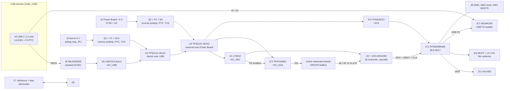
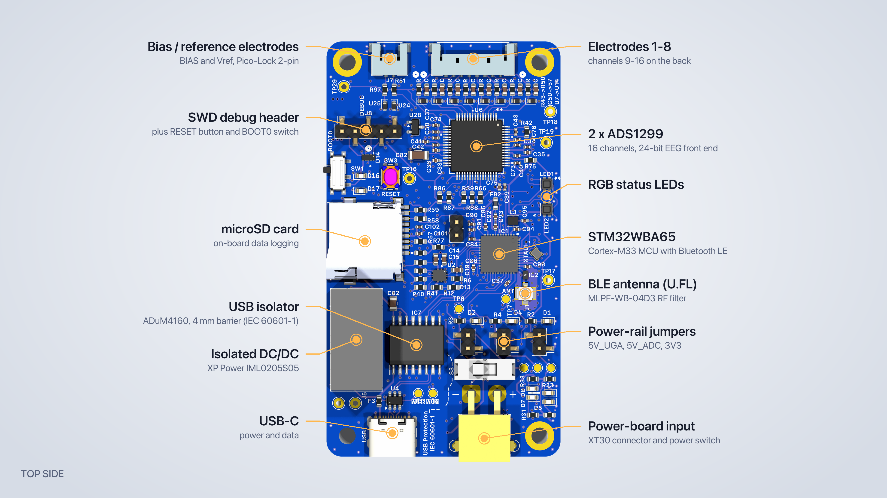
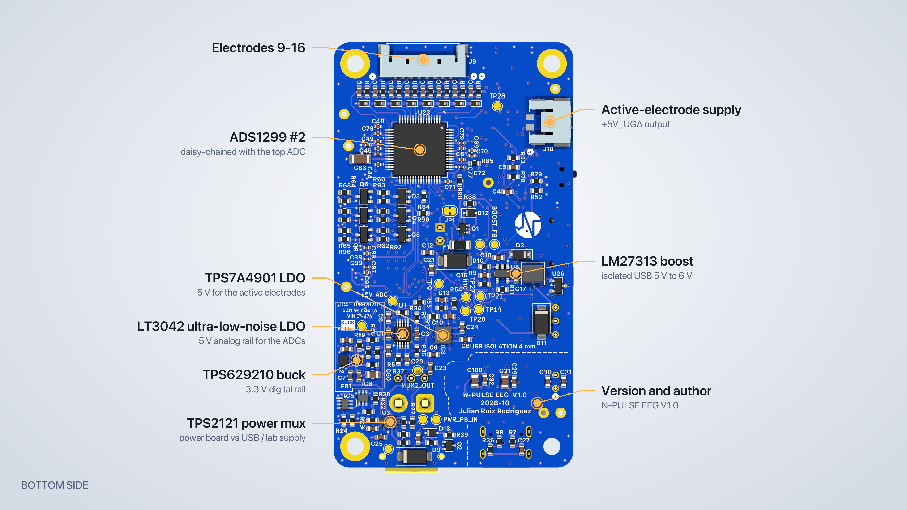

# Design Solution Definition: `EEG Processing Board V1.0`

> **Project:** `N-Pulse (EEG headset)`
> **Document ID:** `DSD-<NNN>-EEG-BOARD`
> **Version:** `0.1.0` · **Status:** `Draft`
> **Project phase:** `Prototype` (first spin of the V1.0 hardware: schematic and layout finished, not yet fabricated)
> **Last modified:** `2026-10-25`
> **Repository path:** `EEG-HW-System/Docs/DSD-EEG-BOARD.md` (branch `feature/decoding_board`)

<!--
HOW TO USE THIS TEMPLATE
- Replace every `<placeholder>`. Delete guidance comments before review.
- One DSD per subsystem or module
- The DSD must stand alone: a reviewer should be able to judge the design
  from this document, the linked requirements, and the linked evidence.
- Normative language: "shall" = requirement, "should" = recommendation,
  "may" = optional.

Items still to be completed by the author are marked **[TO COMPLETE]**.
-->

---

## Document control

### Roles and sign-off

| Role | Name | Affiliation / Handle | Date | Signature / Review link |
|---|---|---|---|---|
| Author(s) | Julian Rodriguez | EEG Board Designer / @Julian-R-R | 2026-10-25 | |
| Reviewer (technical) | **[TO COMPLETE]** | | | |
| Concurrence (SE Reviewer) | **[TO COMPLETE]** | | | |
| Concurrence (Quality management reviewer) | **[TO COMPLETE]** | | | |
| Approval (Project Manager) | **[TO COMPLETE]** | | | |

> Note : Link approval to any relevant PR (Pull Request)
> Affiliation/Handle : Role/ Username on Github

### Modification log

| Version | Date | Author(s) | Main changes | PR / Commit |
|---|---|---|---|---|
| 1.0.0 | 2026-10-25 | Julian Rodriguez | Redesign of the power management circuitry for lower noise level, switching to a store baught antenna for more reliability on the Bleutooth system, rework of the filtering resistor and capacitors at the input if the recording channels.| Branch `feature/decoding_board`, commit `63877d2` ("adding eeg decoding board") |

---

## Table of contents

1. [Introduction](#1-introduction)
2. [Requirements and traceability](#2-requirements-and-traceability)
3. [Concept justification](#3-concept-justification)
4. [Traded-off concepts](#4-traded-off-concepts)
5. [Quality management and compliance](#5-quality-management-and-compliance) /!\ THIS SECTION IS NOT FINALISED /!\
6. [Licensing](#6-licensing) /!\ THIS SECTION IS NOT FINALISED /!\
7. [Open issues and future work](#7-open-issues-and-future-work)
8. [References](#8-references)
9. [Appendices](#9-appendices)

---

## 1. Introduction

### 1.1 Purpose and scope

<!-- Why does this document exist, at which review/milestone is it produced,
and what decision does it support? State what is IN and OUT of scope. 

DO NOT CHANGE ANYTHING IN THIS SECTION EXCEPT THE HIGHLIGHTED SECTIONS -->

This Design Solution Definition (DSD) is at a `Prototype` stage
validated on `10/26`. It justifies the concept selected for `the EEG processing board V1.0 (16-channel EEG acquisition, power path, isolated USB, BLE MCU)`.

It covers:

- the problem the subsystem must solve
- the retained concept: architecture, components, and design choices
- the concepts that were considered and not retained
- risks, quality, and compliance implications.

**Out of scope:** `the battery Power Board (charging, cell protection, under-voltage cut-off); the active electrode boards (project unity_gain_opamp); electrode cap, cables and harness; firmware; BLE/USB host software; enclosure and headset mechanics. These are described only as interfaces (§3.3).`

### 1.2 Responsibility and change authority

<!-- Who owns this document? Who may approve changes? How are changes
proposed (issue, RFC, pull request)? -->

- **Document owner:** `Julian Ruiz Rodriguez (EEG board designer, @Julian-R-R)`
- **Change authority:** **[TO COMPLETE: role / committee that approves changes]**
- **Change process:** changes are proposed as a pull request against the board repository. The schematic is the single source of truth: BOM and fab outputs are regenerated from it.

### 1.3 Abbreviated terms and definitions

| Term | Definition |
|---|---|
| ADC | Analog-to-digital converter |
| AFE | Analog front end |
| AVDD / DVDD | Analog / digital supply of the ADS1299 |
| BLE | Bluetooth Low Energy |
| BOM | Bill of materials |
| C0G | Class-1 ceramic dielectric (stable, no DC-bias or piezo effect) |
| CMRR | Common-mode rejection ratio |
| CSP | Chip-scale package (bumped die) |
| DNP | Do not populate |
| DRC / ERC | Design rule check (PCB) / electrical rule check (schematic) |
| DRL | Driven right leg, here the ADS1299 bias drive to the body |
| DSD | Design Solution Definition |
| EP | Exposed pad (thermal / ground pad under a QFN or MSOP) |
| ESD | Electrostatic discharge |
| FS / HS | USB full speed (12 Mbit/s) / high speed (480 Mbit/s) |
| ICD | Interface Control Document |
| IPD | Integrated passive device (here the MLPF-WB-04D3 matching and filter) |
| LDO | Low-dropout linear regulator |
| MOPP | Means of patient protection (IEC 60601-1) |
| NC / SFC | Normal condition / single-fault condition (IEC 60601-1) |
| PG | Power good |
| PGA | Programmable gain amplifier |
| PSRR | Power-supply rejection ratio |
| PTC | Resettable polymer fuse |
| SMPS | Switched-mode power supply |
| SPS | Samples per second |
| SRB1 | ADS1299 pin used as the common negative input of all channels (referential montage) |
| SWD | Serial Wire Debug |
| TVS | Transient voltage suppressor diode |
| U.FL | Miniature RF coaxial connector (TE CONMHF1) |
| XCOMP | TPS2121 priority mode, set by the PR1 / CP2 dividers |

## 2. Requirements and traceability

<!-- Do not duplicate the full requirements document. Link to it and list only
the requirements this design directly addresses. -->

The project requirements live in the N-Pulse requirements database (Notion) **[TO COMPLETE: link]**. §2.1 lists the ones allocated to the EEG board; §2.2 lists the design-level requirements derived from them during the reviews. The database view shows no IDs, so the IDs below are assigned here by category. **[TO COMPLETE: replace them with the database IDs if they exist, and give the name of the first category (shown here as SYS).]**

#### 2.1 Project requirements allocated to the EEG board

| Requirement ID | Requirement (as in the database) | Also allocated to | Verification method | Status |
|---|---|---|---|---|
| SYS-01 | The EEG headset shall support at least 4 hours of continuous operation from its intended battery while acquiring and transmitting all required channels. | Battery | A, T | **Open.** The board needs ≈ 1.2–2.8 Wh at its input for 4 h (4.6 Wh worst case), before the Power Board's losses (§3.4.1) |
| SYS-02 | Guarantee safe operation of the battery system. | Power Board only | – | Not allocated to this board: battery management is on the Power Board |
| SYS-03 | Not exceed 43 °C on skin contact. | Headset structure | A, M | **Open.** Board loss ≈ 0.3–0.7 W on battery; two temperature sensors and the MCU sensor allow a firmware cut-off; no thermal test yet (OI-19) |
| SYS-04 | Remain within dielectric safety guidelines. | Power Board | I, T | **Met by design** for the USB barrier (1 × MOPP, ≥ 4 mm creepage, IML0205S05 4 kV, ADuM4160 5 kV rms). Hipot pending; guideline to name |
| SYS-05 | Not exceed 10 µA patient leakage current nominal and 50 µA during single fault. | – | A, M | **Partially met.** NC met by analysis. SFC open for a shorted R51 (OI-02) and for the reference path, which relies on the electrode board's series resistor. §3.4.4 |
| ACQ-01 | Simultaneously acquire at least TBD distinct EEG channels. | – | I, T | **Met for up to 16 channels** (2 × ADS1299, shared clock and START). Count TBD (OI-16) |
| ACQ-02 | Each active EEG headset shall be sampled at a rate of at least 256 Hz. | – | T | **Met at ≥ 500 SPS.** The ADS1299 rates are 250, 500, 1000 … SPS, so 250 SPS is too low (OI-13) |
| ACQ-03 | Signal path shall preserve frequencies from 0 Hz to 80 Hz within documented passband. | – | A, T | **Met at ≥ 500 SPS.** DC-coupled chain, input RC corner 7.25 kHz, sinc3 filter −1.1 dB at 80 Hz (500 SPS) or −0.3 dB (1 kSPS). Fails at 250 SPS (−4.5 dB). Passband still to document (OI-13) |
| ACQ-04 | Each EEG BioAmp shall have baseline noise RMS less than 1 µV. | – | A, T | **Met for the board:** ≈ 0.25 µVrms at 500 SPS, inputs shorted at the connectors. **At the limit with the electrode boards:** ≈ 1.0 µVrms with 220 kΩ on the channel and the reference (OI-14) |
| ACQ-05 | Each EEG BioAmp shall have input impedance greater than 100 MΩ. | – | A, T | **Met through the active electrodes** (OPA376 input; ADS1299 1 GΩ DC). The board's own input is only 1.45 MΩ at 50 Hz, so passive electrodes fail.|
| ACQ-06 | Each EEG BioAmp shall have CMRR at 50 Hz greater than 100 dB. | – | A, T | **Met by design:** ADS1299 −110 dB min (−120 dB typ); passive input network 136 dB with 1 % mismatch. In use, electrode-impedance mismatch lowers it and the DRL loop helps. T pending |
| ACQ-07 | EEG ADC shall have resolution of at least 24 bit. | – | I | **Met** (24-bit Δ-Σ) |
| ACQ-08 | EEG BioAmp shall have input range of at least TBD mV peak-to-peak. | – | A | **TBD.** 375 mVpp at gain 24, 750 mVpp at gain 12, up to 9 Vpp at gain 1 (OI-16) |
| COM-01 | Decoding module shall communicate with the prosthesis control board. | – | D, T | **Open.** BLE and isolated USB are available; no wired port; no interface document (OI-17) |
| COM-02 | The EEG signal acquisition, decoding and communication (mock communication for S1) with the prosthesis shall take less than 250 ms. | – | A, T | **Open.** ≈ 50 ms budget for acquisition and BLE transport (§3.4.3); decoding not defined yet (OI-18) |
| SAF-01 | EEG headset shall remain within Electromagnetic compatibility (EMC) standards. | – | T | **Open.** Design measures in §3.2.11; standard to name; the radio is a chip-down design |
| SAF-02 | EEG headset shall ensure patient ESD protection. | Headset structure | I, T | **Met by design:** an ESD diode on all 18 skin contacts at the connectors, plus USB and SWD protection. Test level to name |

#### 2.2 Derived design requirements

| ID | Derived requirement | Traces to | Verification method | Status |
|---|---|---|---|---|
| DR-01 | Power the active electrodes from a dedicated low-noise 5 V rail. | ACQ-04, ACQ-05 | A, I | Met by design: 150 mA rating vs ≈ 19 mA load (§3.2.4) |
| DR-02 | Provide a common reference input and a bias (DRL) electrode drive. | ACQ-06 | I | Met by design (§3.2.3) |
| DR-03 | Isolate the wired USB link from the patient circuit (≥ 1 × MOPP, ≥ 4 mm creepage). | SYS-04, SYS-05 | I, T | Met by design (DRC rule area); hipot and megger pending |
| DR-04 | Stream the data wirelessly over BLE. | COM-01, COM-02 | T | Open: firmware not written |
| DR-05 | Log the data to a local microSD card. | – | I, T | Met by design; T pending |
| DR-06 | Run from the Power Board (≈ 6 V); accept USB and a bench supply as secondary and debug sources. | SYS-01 | I | Met by design (§3.2.5) |
| DR-07 | Switch sources automatically without resetting the MCU. | SYS-01 | T | T pending (§3.2.6) |
| DR-08 | Protect every power input against reverse polarity, over-current and transients. | SYS-04 | I, A | Partially met (OI-03) |
| DR-09 | Stay within the Power Board's output power (≤ 1.14 W worst case). | SYS-01 | A, M | Met by analysis; M pending (§3.4.1) |
| DR-10 | Never let the electrode buffers drive an unpowered ADC. | – | I, T | Met by design (TPS7A4901 EN = LT3042 PG) |
| DR-11 | Monitor the board temperature. | SYS-03 | I | Met by design: 2 × MCP9700A + MCU sensor |
| DR-12 | Be programmable and debuggable in-system. | – | I, D | Met by design (SWD + ROM bootloader); see OI-01 (NRST) |
| DR-14 | Fit a head-worn form factor. **[TO COMPLETE: size and mass targets]** | – | I | Board is 45 × 80 mm; target TBC (§3.4.6) |

> **Verification methods:** (D)emonstration, (T)est, (M)easurement, (I)nspection, (A)nalysis

---

## 3. Concept justification

The board has to turn microvolt-level scalp potentials from 16 active electrodes into synchronised 24-bit samples, then stream or store them, while it is worn on the head of a volunteer. Three needs drive almost every choice below: **signal quality** (noise, synchronisation, crosstalk), **patient safety** (leakage and fault currents, isolation from mains-referenced equipment) and **power from a separate battery board**, with USB and a bench supply for development.

### 3.1 Solution overview

Two TI ADS1299 front ends in cascade digitise 16 referential channels against a common reference (SRB1) and drive the body to mid-supply through a current-limited bias electrode. Each analog consumer has its own low-noise rail: an LT3042 for the ADC AVDD and a TPS7A4901 for the electrode buffers. The second rail starts only after the first is good. An STM32WBA65 BLE MCU, on its own buck-regulated 3.3 V rail, reads both ADCs over SPI and sends the data over BLE (U.FL antenna), over USB or to a microSD card. Power comes from the battery Power Board, from USB through a medical-grade isolation barrier (ADuM4160 + IML0205S05), or from a bench supply for debug only. Two TPS2121 muxes select the source automatically.

*Figure 3.1: High-level architecture of the EEG processing board V1.0. The USB domain is the only part of the board not referenced to the patient ground.*

| Top (annotated) | Bottom (annotated) |
|---|---|
|  |  |

*Figure 3.2: Rendered V1.0 board, 45 × 80 mm.*

### 3.2 Main design choices

#### 3.2.1 Analog front end: 2 × ADS1299 in cascade

- **Decision:** two TI ADS1299IPAG. U6 handles channels 1–8 (F.Cu) and U23 channels 9–16 (B.Cu, same XY, mirrored).
  - SPI1: shared SCLK / DIN / DOUT, separate CS1 / CS2, shared START.
  - U6 is the clock master (CLKSEL = 1 through R75 10 kΩ, firmware sets CLK_EN = 1, 2.048 MHz on CLK). U23 is the slave (CLKSEL = 0 through R85).
  - Only U6's DRDY goes to the MCU (PC13). U23's DRDY has a weak pull-up (R98).
  - AVDD = +5V_ADC, AVSS = GND (unipolar 0–5 V), DVDD = +3V3. Internal 4.5 V reference, PGA up to ×24, so the input range is ±187.5 mV at gain 24.
- **Rationale:**
  - The ADS1299 integrates 8 simultaneous 24-bit Δ-Σ channels, a PGA, bias drive and lead-off detection, with about 1 µVpp input noise in the EEG band (datasheet typical).
  - It is the de facto standard EEG front end (also used in open EEG platforms such as OpenBCI), so reference designs and application notes are plentiful.
  - The clock master/slave arrangement and the shared START make all 16 channels sample at the same instant, which coherence and source-localisation analyses need.
- **Requirements addressed:** ACQ-01, ACQ-02, ACQ-03, ACQ-04, ACQ-06, ACQ-07, ACQ-08, DR-02
- **Consequences / limitations:**
  - **Data rate ≥ 500 SPS.** With the 2.048 MHz clock the rates are 250, 500, 1000 … 16 000 SPS. 250 SPS is below the 256 Hz of ACQ-02, and its sinc3 filter is already −4.5 dB at 80 Hz (ACQ-03). At 500 SPS the bandwidth is 131 Hz (−1.1 dB at 80 Hz) and the noise is 0.20 µVrms at gain 24 (datasheet Table 4).
  - Firmware must follow a clock-init sequence: the shared RESET clears CLK_EN, so U23 has no clock until U6 is configured.
  - The ADS1299 is the most expensive part and is bought from TI directly.
  - TQFP-64 at 0.5 mm pitch on both board sides, so both sides need reflow.
  - Lead-off detection cannot see the electrode–skin contact through the active buffers. Contact quality has to be checked another way (50 Hz amplitude, AC test signal, or on the electrode board).

#### 3.2.2 Electrode input network

- **Decision:**
  - 4.99 kΩ 0.1 % thin film (Yageo RT0603BRD074K99L) in series with each input.
  - 2.2 nF C0G 1 % (Yageo CC0603FRNPO9BN222) **differentially** from each INxP to SRB1.
  - One TI TPD1E05U06 ESD diode per electrode, reference and bias line (18 in total), at the connector.
  - Unused INxN pins tied to AVDD through 10 kΩ, with MISC1.SRB1 = 1.
- **Rationale:**
  - It follows TI SBAS499 §10.2: a differential capacitor keeps CMRR independent of part tolerance.
  - Channel corner 1/(2π·2R·C) = 7.25 kHz, which is enough attenuation at f_MOD = 1.024 MHz for a Δ-Σ converter.
  - The SRB1 node sees 16 × 2.2 nF through 4.99 kΩ, a pole at 906 Hz, so the montage stays referential across the EEG band. With the original 20 nF, the reference became frequency-dependent above about 10 Hz and crosstalk was about 3 % at 50 Hz.
  - Resistor noise is 105 nVrms (0.5–65 Hz), below the ADS1299's own ≈ 0.14 µVrms.
  - The ESD diodes leak ≤ 10 nA, so they don't bias the high-impedance inputs.
- **Requirements addressed:** ACQ-03, ACQ-04, ACQ-05, ACQ-06, SAF-02, DR-02
- **Consequences / limitations:**
  - The 4.99 kΩ resistors are **not** the patient current limit. That limit lives on the electrode board (220 kΩ at each skin input).
  - Passive electrodes are not supported by this network. Seen from an electrode, the 2.2 nF to SRB1 is only 1.45 MΩ at 50 Hz, far below the 100 MΩ of ACQ-05, so ACQ-05 is met only through the active electrode buffers. Passive electrodes would need about 47 kΩ-class series resistors with the caps moved to AVSS.

#### 3.2.3 Reference and bias (DRL)

- **Decision:**
  - **Referential montage:** reference electrode on J7.2 → R97 4.99 kΩ → SRB1, the common IN− of all 16 channels.
  - **Bias:** U6 BIASOUT with R42 1 MΩ ∥ C43 1.5 nF C0G to BIASINV. The BIASINV pins of both chips are tied together, so the common mode is sensed from all 16 channels. U23's bias amplifier is powered down.
  - BIASOUT → R51 (series current limit) → BIAS_ELEC on J7.1, with ESD diode U24 and test point TP28. BIASREF is internal (mid-supply ≈ 2.5 V).
- **Rationale:**
  - This is the multi-device bias scheme of the datasheet (§9.3.2.4.5.1).
  - R51 limits the single-fault DC current to 5 V / 505 kΩ ≈ 9.9 µA (12.8 µA with the 390 kΩ part in the MPN field), below the 50 µA SFC limit.
  - The loop is sensed at BIASOUT, before R51, so the series resistor doesn't move the bias point.
- **Requirements addressed:** DR-02, SYS-05, ACQ-06
- **Consequences / limitations:**
  - A shorted R51 would let mA flow (OI-02).
  - The reference path only has 4.99 kΩ on this board. It relies on the reference electrode's own series impedance.
  - Keep < 50 pF on the far side of R51 so the bias loop stays stable.

#### 3.2.4 Active-electrode supply and rail sequencing

- **Decision:**
  - A dedicated +5V_UGA rail from a TI TPS7A4901 (1.194 V × (1 + 320k/100k) = 5.01 V, 150 mA, ≈ 15 µVrms with 10 nF NR/SS and 10 nF CFF; divider R17/R18 in 0.5 % thin film), delivered to the electrode boards on J10.
  - Its EN pin is driven by the LT3042 PG output. PG trips at ≈ 4.71 V through the PGFB divider R34 147 kΩ / R35 10 kΩ, with R37 100 kΩ pull-up.
- **Rationale:**
  - The buffer current stays off the ADC rail.
  - The buffers share the 0–5 V span with AVDD, so the ≈ 2.5 V bias point sits in the middle of their range.
  - The sequencing stops the buffers from driving an unpowered ADS1299, which would back-power AVDD through the input ESD clamps (≈ 1 mA per channel).
- **Requirements addressed:** DR-01, DR-10
- **Consequences / limitations:**
  - A single 2-pin J10 supplies both electrode cables. The electrode-board interface must be specified.
  - Bring-up rule: close JP3 (+5V_ADC) before JP2 (+5V_UGA), always.

#### 3.2.5 Power inputs and protection

- **Decision:** three inputs. Each one has a reverse-polarity "ideal diode" P-MOSFET (onsemi NTS4173PT1G, SC-70, with an MM3Z10VST1G 10 V zener and 100 kΩ on the gate), a resettable PTC and a 400 W TVS (Littelfuse SMAJ15A).

  | Input | Connector | Chain | Note |
  |---|---|---|---|
  | Power Board (main) | J2 AMASS XT30PW-M (polarized) | S3 E-Switch EG1218 → Q2 → F2 Bourns MF-FSML050/8-2 (0.5 A) → D9 | Regulated ≈ 6 V from the battery board |
  | Bench (debug only) | J3 2.54 mm header (Würth 61300211121) | JP1 → Q1 → F1 Littelfuse 1206L050/15YR (0.5 A, 15 V) → D10 | MUX1 OV divider R40 845 kΩ / R41 100 kΩ (≈ 10 V cut-off, assuming the 1.06 V TPS2121 threshold) |
  | USB | J4 USB-C 2.0 receptacle (GCT USB4105) | 5.1 kΩ Rd on CC1 and CC2 (plain sink, ≤ 500 mA, no PD) → U4 USBLC6-2SC6 ESD → F3 MF-FSML050/8-2 | Then the isolation barrier (§3.2.8) |

- **Rationale:**
  - The P-MOSFET drops tens of mV, against 0.3–0.7 V for a diode. This matters because the LT3042 needs ≥ 5.35 V from a ≈ 6 V source. The zener clamps V_GS on over-voltage.
  - The PTC keeps a downstream short from killing the battery or the USB port.
  - The TVS clamps transients on each input.
- **Requirements addressed:** DR-06, DR-08, SYS-04
- **Consequences / limitations:**
  - J3 is unkeyed; acceptable for a debug-only input.
  - S3 is rated 200 mA (OI-04).

#### 3.2.6 Automatic power path (2 × TPS2121)

- **Decision:** two TI TPS2121RUXR priority muxes (2.8–22 V, 56 mΩ, ILIM 80.6 kΩ → 1.5 A, soft start 100 nF ≈ 8 ms).
  - **MUX1 (U2):** bench (IN1) over USB +6V (IN2).
  - **MUX2 (U3):** MUX1 output (IN1) over the Power Board (IN2).
  - XCOMP priority set by the PR1 / CP2 dividers (33.2k/10k and 38.3k/10k, VREF 1.06 V). IN1 is kept while V_IN1 > 0.894·V_IN2: the bench stays selected down to ≈ 5.36 V on MUX1, and the external source stays selected down to ≈ 5.63 V on MUX2 against a 6.3 V Power Board.
  - The ST outputs drive 2N7002DW inverters, giving one green LED per source (D5–D8, ≈ 1 mA). ST is pulled up to +3V3 (abs max 6 V), never to the 6 V rail.
- **Rationale:** glitch-free switching without OR-ing diodes (no 0.4 V loss), a current limit, and a visible status.
- **Requirements addressed:** DR-06, DR-07
- **Consequences / limitations:**
  - The battery has the lowest priority: bench work never drains it. Rev 2 may flip this (OI-10).
  - The ST signals only drive the LEDs. They are not routed to the MCU (OI-06).

#### 3.2.7 Regulated rails

| Rail | Regulator | Output | Loads | Why this part |
|---|---|---|---|---|
| **+5V_ADC** | ADI LT3042EMSE (200 mA) | 100 µA × R1 50.0 kΩ 0.1 % / 25 ppm = 5.00 V | ADS1299 AVDD × 2, rail LED D4 | Lowest-noise LDO class: 0.8 µVrms (10 Hz–100 kHz), 79 dB PSRR at 1 MHz. CSET 4.7 µF filters the reference noise above 0.68 Hz. Fast start-up and PG through PGFB. |
| **+5V_UGA** | TI TPS7A4901 (150 mA) | 5.01 V | Active electrode boards (J10), rail LED D2 | §3.2.4 |
| **+3V3** | TI TPS629210 1 A buck (SOT-583) + Murata DFE201610E 2.2 µH | 0.6 V × (1 + 619k/137k) = 3.31 V | MCU and radio, ADS1299 DVDD, microSD, LEDs, ADuM4160 side 2, temperature sensors | Efficient for ~40 mA RF bursts and SD writes up to 150 mA. Auto PFM/PWM (R5 = 0 Ω on MODE; 9.31 kΩ gives forced PWM if needed). Input filter FB1 BLM18KG601 + 4.7 µF / 100 nF keeps the switching current off MUX2_OUT, which also feeds both LDOs. |

- **Rationale:** one regulator per rail, so the analog rails never see the digital and RF load steps. In the first draft, MCU current flowed through the analog LDO.
- **Requirements addressed:** ACQ-04, DR-01, DR-09, DR-10
- **Consequences / limitations:** AVDD − DVDD = 1.7 V, inside the 3.6 V limit. The LT3042 needs ≥ 5.35 V at its input (350 mV dropout at 200 mA, less at the real 21 mA load).

#### 3.2.8 Isolated USB link

- **Decision:**
  - **Data:** ADI ADuM4160BRWZ USB 2.0 isolator (5 kV rms). SPD is tied high (full speed). PIN is driven by MCU PD8, so firmware controls when the device connects.
  - **Power:** XP Power IML0205S05 (2 W, 5 V → 5 V, 4 kV isolation, IEC 60601-1 approvals, 1 × MOPP at 300 VAC, ≈ 2 µA leakage).
  - **Boost:** TI LM27313 (1.6 MHz, Würth WE-MAPI 4030 10 µH, ST STPS0520Z Schottky) to +6V_USB = 1.23 × (1 + 51.1k/13.3k) = 5.96 V, so USB enters the same power path as the other sources.
  - USB shield to GND_USB through 1 MΩ ∥ 4.7 nF 100 V.
- **Rationale:** a wired data and power link with no galvanic path from a mains-powered PC to the subject's head. Full speed (12 Mbit/s) is far above the 0.43 Mbit/s that 16 channels need at 1 kSPS.
- **Requirements addressed:** SYS-04, SYS-05, DR-03
- **Consequences / limitations:**
  - The barrier is 1 × MOPP, not 2 × MOPP. With a subject connected, the laptop must run on battery with its charger unplugged (OI-12).
  - A 4 mm creepage barrier must be kept free on all four copper layers (§3.2.11).
  - The WBA65 has a high-speed PHY: firmware must force full speed.
  - The ADuM4160 is the most expensive line after the ADS1299 (≈ 13 CHF).

#### 3.2.9 MCU and BLE radio

- **Decision:**
  - **MCU:** ST STM32WBA65CIU6 (UFQFPN48, Cortex-M33 at 100 MHz, 2 MB flash, 512 kB RAM, BLE 5 + 802.15.4, USB OTG).
  - **Internal SMPS:** VLXSMPS → L3 2.2 µH (DFE201610E) → VDD11 with 4.7 µF. VDDANA and VDDRFPA are fed from VDD11.
  - **HSE:** NDK NX2016SA 32 MHz. The WBA has trimmable internal load caps, so no external caps are needed.
  - **RF chain:** pin 37 → 63 Ω line (0.10 mm, ≈ 1.5 mm) → ST MLPF-WB-04D3 IPD (matching + harmonic filter) → 50 Ω line (0.16 mm) → TE CONMHF1 U.FL → Molex 1461530050 flex antenna on a 50 mm cable.
- **Rationale:**
  - One chip gives BLE and USB, with enough RAM to buffer 16-channel data.
  - The IPD replaces a discrete matching network that would have to be tuned with a VNA.
  - An external antenna can sit away from the head and the AFE. On the board, the RF corner is ≈ 40 mm from the AFE.
- **Requirements addressed:** COM-01, COM-02, DR-04, DR-12
- **Consequences / limitations:**
  - With VDDRFPA on VDD11, the specified TX power is capped (7.5 dBm is specified only for VDDRFPA ≥ 1.71 V) (OI-08).
  - The MLPF is a bumped CSP: it needs machine placement and impedance-controlled lines.
  - The coax shield is the patient ground, so the antenna must be fully insulated.

#### 3.2.10 Local storage, debug, indicators and temperature

- **microSD:** Same Sky MSD-1-A (J11) on SPI3 (PA7 SCK, PB8 MOSI, PA1 MISO, PB14 CS), with 10 µF + 100 nF at the socket.
- **Debug:** 1 × 5 SWD header J8 (+3V3, NRST, SWDIO, SWCLK, GND) with a TPD4E05U06 ESD array (D14), reset button SW3 (Alps SKRPABE010), and a BOOT0 slide switch SW1 (C&K PCM12) for the ROM bootloader.
- **Indicators:**
  - rail LEDs D1 (+3V3), D2 (+5V_UGA), D4 (+5V_ADC);
  - source LEDs D5–D8;
  - RGB LEDs LED1 / LED2 (Cree CLMVC-FKA), driven by ADS1299 GPIO2–4 through BSS138s with 100 kΩ gate pull-downs. They use no MCU pins and stay static during acquisition;
  - red LEDs D16 on NRST and D17 on BOOT0. **D16 is a likely defect (OI-01).**
- **Temperature:** 2 × Microchip MCP9700A on MCU ADC pins: U26 next to the IML0205S05 (≈ 0.4 W loss) on PA6, U28 on PA8. A third sensor (U27) was removed during layout; the MCU internal sensor covers that area.
- **Requirements addressed:** DR-05, DR-11, DR-12, SYS-03, SAF-02
- **Consequences / limitations:** SD write bursts (100–150 mA) set the +3V3 worst case and the S3 rating problem (OI-04).

#### 3.2.11 PCB implementation

- **Board:** 4 layers, 45 × 80 mm, ≈ 1.6 mm (F.Cu / 0.1 mm prepreg / In1 GND / 1.24 mm core / In2 GND / 0.1 mm prepreg / B.Cu, FR4 εr 4.5, 35 µm copper). Parts on both sides.
- **Floorplan:**
  - Analog at the top (electrode connectors, both ADCs), digital in the middle (MCU, SD card), power at the bottom.
  - One GND for analog and digital (AVSS = DGND = GND, as TI recommends). Separation comes from placement, not from splits.
  - No digital trace under the electrode inputs or the RC network on any layer. Both inner planes are solid under the AFE.
- **USB isolation:**
  - The USB domain is the bottom-left corner, with its own GND_USB pour.
  - A rule area "USB isolation barrier (1 MOPP, 4 mm)" on all copper layers keeps it free; DRC enforces ≥ 4 mm.
  - The barrier is marked on the silkscreen.
- **RF corner:**
  - In1 is solid under it, and a rule area "RF corner: no inner-layer tracks" keeps other routing out.
  - It has an F.Cu GND pour (0.35 mm gap, solid connection) and a via fence at ≤ 1 mm pitch.
  - IC2 has 0.22 mm mask and paste openings, per ST.
- **Ground vias:** 313 GND / GND_USB vias and GND through-hole pads in total (pad returns, signal-via returns, RF fence, edge fence, plane stitching).
- **Minimums:** board 0.15 mm track / 0.45 mm via / 0.2 mm drill; net-class default 0.2 / 0.6 / 0.3.
- **Status on 13 Oct 2026:**
  - fully routed, 0 unconnected, 0 schematic-parity errors;
  - the remaining DRC items are known and accepted (§7);
  - 3D models on every real part;
  - silkscreen title "N-PULSE EEG V1.0".
- **Consequences / limitations:**
  - The inner GND planes also carry signals, so they are slotted under the digital half.
  - A 6-layer stackup is explored for V1.1 (§4.7, OI-11).

#### 3.2.12 Bring-up and test aids

- **Rail-break jumpers:** JP2–JP4 (2-pin headers + shunts) on +5V_UGA, +5V_ADC and +3V3, with 0 Ω R54–R56 in parallel. R54–R56 are DNP; they are fitted instead of shunts on volunteer boards.
- **Regulator-side sensing:** feedback and PG are taken on the regulator side of each jumper, so each regulator can be checked with its jumper open.
- **Test points:** 28 in total: 22 SMD 1.5 mm pads on B.Cu (rails, mux nodes, feedback nodes), plus 6 THT pads for GND, GND_USB and SRB1 (scope ground clips).
- **Status signal:** BUCK_PG goes to the MCU (PD9).
- **Requirements addressed:** DR-12

### 3.3 Functionally linked systems

| System | Role | Interface with this board | Status |
|---|---|---|---|
| Battery Power Board | Owns the battery: charging, protection, under-voltage cut-off | J2 XT30, regulated ≈ 6 V (5.7–6.3 V assumed). Must deliver ≥ 1.2 W | Completed |
| Active electrode boards (`../unity_gain_opamp`) | One OPA376 unity-gain buffer per electrode. Its schematic shows 220 kΩ in series at the skin input, 10 pF to GND and 220 Ω at the output | Power from J10 (+5V_UGA, GND); signals on J6 / J9 (8 electrodes per cable); reference / bias on J7 | Completed |
| Electrode cap, cables and harness | Mechanical holding of the electrodes, cable routing | J6 / J9 Molex Pico-Lock 504050-0891, J7 504050-0291, J10 Molex 205338-0002 | Selected |
| BLE antenna | Radio link | J1 U.FL, Molex 1461530050 flex antenna (50 mm cable), ordered with the BOM | Selected |
| Firmware (STM32WBA65) | Acquisition, BLE / USB / SD, safety register lock | SWD (J8), ROM bootloader (SW1) | In Progress |
| USB host (laptop) | Wired link, development | USB-C. On battery, charger unplugged, when a subject is connected | Operating rule |
| Enclosure / headset mechanics | Protection, mounting (4 × M3 holes) | Insulated antenna, SD card sticking out ≈ 5 mm, IML0205S05 heat away from the head | In Progress|

### 3.4 Performance budgets and design margins

#### 3.4.1 Power

Worst case: all LEDs lit, radio transmitting, USB active, SD card writing, bias amplifier driving the body.

| Rail | Rating | Worst-case load | Use of rating |
|---|---|---|---|
| +3V3 (TPS629210) | 1 A | ≈ 232 mA (≈ 82 mA without the SD card) | 23 % |
| +5V_ADC (LT3042) | 200 mA | ≈ 21 mA | 10 % |
| +5V_UGA (TPS7A4901) | 150 mA | ≈ 19 mA (16 × OPA376 at 950 µA max, one reference buffer, LED) | 13 % |
| MUX2_OUT at 5.4 V (buck efficiency 85 %) | – | ≈ 210 mA / 1.14 W (≈ 100 mA / 0.54 W without the SD card) | – |

| Source | Worst-case current | Limit | Status |
|---|---|---|---|
| Power Board J2 (5.4 V) | ≈ 210 mA | F2 0.5 A, Q2 1 A, **S3 EG1218 200 mA** | ❌ S3 exceeded (OI-04) |
| Bench J3 | ≈ 210 mA | F1 0.5 A, mux limit 1.5 A | ✅ |
| USB VBUS | 350 mA at 5.0 V, 370 mA at 4.75 V, ≈ 430 mA with 200 mA SD peaks | USB 2.0 default port 500 mA, F3 0.5 A | ✅, 26 % margin. Not enough for 100 mA bus-powered hub ports |
| IML0205S05 output | ≈ 1.37 W | 2 W | ✅ 69 % |
| LM27313 switch | ≈ 0.31 A peak | 0.8 A minimum limit | ✅ |

- **Typical consumption:** ≈ 50 mA at 6 V (≈ 0.3 W) without SD logging (est., 2026-10-03); ≈ 0.6–0.7 W with SD logging at 16 ch × 1 kSPS (est.).
- **4 h of operation (SYS-01).** Energy needed at the board input (J2):

  | Case | Board power | Energy for 4 h |
  |---|---|---|
  | Streaming, no SD logging (typical, est.) | ≈ 0.3 W | ≈ 1.2 Wh |
  | SD logging at 16 ch × 1 kSPS (est.) | ≈ 0.6–0.7 W | ≈ 2.4–2.8 Wh |
  | Worst case (everything on, SD writing) | 1.14 W | ≈ 4.6 Wh |

#### 3.4.2 Signal chain

ADS1299 figures are from the datasheet (SBAS499C, Tables 1–4 and the electrical characteristics). The sinc3 attenuation at 80 Hz is computed with the sinc³ approximation, which matches the datasheet's −3 dB point of 0.262 × data rate.

| Quantity | Value | Requirement / comment |
|---|---|---|
| Data rate | ≥ 500 SPS. Available rates: 250, 500, 1000 … 16 000 SPS | ACQ-02 (≥ 256 Hz) excludes 250 SPS (OI-13) |
| Passband | DC-coupled chain. −3 dB at 131 Hz (500 SPS) or 262 Hz (1 kSPS). At 80 Hz: −1.1 dB (500 SPS), −0.3 dB (1 kSPS), −4.5 dB (250 SPS) | ACQ-03. The input RC corner (7.25 kHz) and the electrode boards (10 pF × 220 kΩ = 72 kHz) are far above |
| Input range | ±187.5 mV (375 mVpp) at gain 24; ±375 mV at gain 12; up to ±4.5 V at gain 1 | ACQ-08 (TBD). Electrode DC offsets of up to ±300 mV may need gain 12 (0.23 µVrms at 500 SPS) |
| Input-referred noise, board only, 0.5–131 Hz (500 SPS, gain 24) | ≈ 0.25 µVrms: 0.20 µVrms ADS1299 + ≈ 0.15 µVrms from the 4.99 kΩ resistors (ideal reference) | ACQ-04 (< 1 µVrms) ✅. At 250 SPS it would be ≈ 0.17 µVrms |
| Noise added by the electrode boards | Each 220 kΩ series resistor: 61 nV/√Hz at 37 °C, so 0.70 µVrms in 0.5–131 Hz. Channel total ≈ 0.75 µVrms with a passive reference, ≈ 1.0 µVrms if the reference also goes through 220 kΩ (OPA376 noise not included) | ACQ-04 at the limit at system level (OI-14) |
| Input impedance | ADS1299: 1 GΩ DC (500 MΩ with 6 nA lead-off). Electrode board: OPA376 input in parallel with 10 pF, i.e. 318 MΩ at 50 Hz and ≈ 200 MΩ at 80 Hz before strays. This board alone: 1.45 MΩ at 50 Hz (2.2 nF to SRB1) | ACQ-05 (> 100 MΩ): met only through the active electrodes (OI-15) |
| CMRR at 50 Hz | ADS1299 −110 dB min, −120 dB typ. Passive input network: 136 dB with 1 % R mismatch, 84 dB with a 20 kΩ passive reference | ACQ-06 (> 100 dB) ✅ for the board. In use the DRL loop also lowers the common-mode voltage |
| Channel corner / SRB1 pole | 7.25 kHz / 906 Hz | Both far above the 80 Hz band |
| Channel-to-channel crosstalk at 50 Hz | −49 dB (ideal reference), −36 dB (20 kΩ passive reference) | Was −30 dB with 20 nF caps |
| Channel matching (R and C both +1 %) | < 0.006° phase at 40 Hz | Transparent for coherence analyses |
| DC offset from ESD leakage (≤ 10 nA) / lead-off 6 nA | ≤ 50 µV / 30 µV | |
| Supply noise | LT3042 0.8 µVrms, TPS7A4901 ≈ 15 µVrms | |

#### 3.4.3 Data rate and compute

One DRDY event reads 2 × (24 status bits + 8 × 24 data bits) = 432 bits over SPI1.

| Sample rate | SPI1 read throughput | EEG payload (16 × 24 bit) | Comment |
|---|---|---|---|
| 250 SPS | 108 kbit/s | 96 kbit/s (12 kB/s) | Below ACQ-02, not used |
| 500 SPS | 216 kbit/s | 192 kbit/s (24 kB/s) | Minimum rate that meets ACQ-02 and ACQ-03 |
| 1 kSPS | 432 kbit/s | 384 kbit/s (48 kB/s) | USB FS (12 Mbit/s) has a large margin. BLE throughput must be verified (T) |

- **RAM:** 512 kB holds at most ≈ 10 s of raw data at 1 kSPS, before firmware use.
- **Latency (COM-02, < 250 ms from acquisition to the prosthesis).** Estimate at 500 SPS; the firmware and decoder values are assumptions to confirm:

  | Stage | Estimate |
  |---|---|
  | ADS1299 digital filter (sinc3 group delay ≈ 1.5 sample periods) | ≈ 3 ms |
  | Packing samples into BLE notifications (e.g. 10 samples per packet) | ≈ 20 ms |
  | BLE transport (1–2 connection intervals at 15 ms; 7.5 ms is the minimum) | ≈ 15–30 ms, more with retransmissions |
  | **Subtotal on the EEG-board side** | **≈ 50 ms** |
  | Decoding window, compute and link to the prosthesis (mock in S1) | ≈ 200 ms left **[TO COMPLETE: decoder window, where decoding runs]** |

- **BLE throughput:** 192 kbit/s of payload at 500 SPS must be sustained. **[TO COMPLETE: measured value, firmware-dependent]**

#### 3.4.4 Patient current and isolation

| Skin contact / path | Normal condition | Single fault | Limit NC / SFC | Status |
|---|---|---|---|---|
| Bias electrode J7.1 (R51) | nA (no other DC return) | 9.9 µA with 505 kΩ, 12.8 µA with 390 kΩ; **mA if R51 is shorted** | 10 / 50 µA | ✅  OI-02 |
| Reference electrode J7.2 (R97 4.99 kΩ) | pA | 22.7 µA with an active electrode board with 220 kΩ at the skin | 10 / 50 µA | ✅ |
| Active electrodes J6 / J9 | pA (OPA376 bias current) | 5 V / 220 kΩ = 22.7 µA (electrode board R1) | 10 / 50 µA | ✅ |
| Through the USB isolation | ≈ 2–3 µA | a few µA | 10 / 50 µA | ✅ |
| Bench input J3 | Not isolated | Unbounded | – | ❌ by design: debug only |
| Battery operation | ≈ 0 (floating system) | – | – | ✅ |
| Lead-off current | 6 / 24 nA only in human mode *(FW)* | – | 10 µA | The 6 / 24 µA settings are forbidden in human mode |

- **Isolation:** 1 × MOPP at ≤ 250 V rms needs ≥ 4 mm creepage and 2.5 mm clearance.
  - Achieved: ≥ 4 mm on all four copper layers, enforced by DRC.
  - Barrier parts: IML0205S05 4 kV, ADuM4160 5 kV rms.
  - Bring-up check: GND_USB ↔ GND > 100 MΩ (megger).

#### 3.4.5 Thermal

LT3042 ≈ 32 mW, TPS7A4901 ≈ 29 mW, buck losses ≈ 0.14 W, IML0205S05 ≈ 0.4 W at full load. Nothing needs extra copper beyond the exposed pads. Keep the IML0205S05 away from the head side of the enclosure; U26 monitors it.

SYS-03 limits the skin-contact temperature to 43 °C. On battery the board dissipates ≈ 0.3–0.7 W spread over 45 × 80 mm; on USB the IML0205S05 adds up to ≈ 0.4 W in one spot. No thermal analysis of the board in its enclosure has been done yet. It has to be measured on the skin side, and firmware can stop logging or radio activity on a U26 / U28 threshold (OI-19).

#### 3.4.6 Mass and size

- Board 45 × 80 × 1.6 mm. Tallest part: IML0205S05 (19.5 × 9.8 × 12.5 mm body).
- **[TO COMPLETE: board mass, assembled mass, and the size / mass targets of the headset]**

#### 3.4.7 Cost (one board, prices of 2026-10-06)

| Supplier | Lines | Cost |
|---|---|---|
| Mouser | 78 lines, 479 pcs incl. spares (91.25 CHF), plus an optional LED colour kit (7.00 CHF) | 98.25 CHF |
| DigiKey | 4 lines (crystal, IML0205S05, TPD1E05U06 × 18, J7) | 15.93 CHF |
| TME | AMASS XT30PW-M | not priced |
| TI (direct) | 2 × ADS1299IPAG | **[TO COMPLETE]** |
| PCB fabrication and assembly | 4-layer, 45 × 80 mm, ENIG, both sides | not priced |

---

## 4. Traded-off concepts

<!-- Show your work. This section protects the project from re-litigating
decisions and records why alternatives were rejected. -->

This section records the alternatives that were studied during the design reviews of September and October 2026 and why they were not retained. Alternatives come from three sources: earlier revisions of this board, the V0 processing board (`../BMI-EEG-HW-CompBoard-main`), and options raised in the reviews in `Docs/`.

> The weights and scores below are **proposed by the author from the design notes**.

### 4.1 Trade-off method

The trade-off method used was based on the following criteria : 
- Meets performance requirements (signal quality, channel count, throughput, robustness)
- Patient safety (leakage and fault currents, isolation, safe defaults)
- Cost
- Reproducibility and accessibility (hand assembly, standard parts, documentation)
- Supply chain robustness (stock, lifecycle, second sources)
- Maintainability and community support (reference designs, application notes, ecosystem)

| Criterion | Weight (1 - 5) | Rationale for weight |
|---|---|---|
| Meets performance requirements | 5 | The board exists to record research-grade EEG. A design that degrades the signal defeats its purpose. |
| Patient safety | 5 | The board is worn on the head of volunteers and connects to the skin through 18 contacts. Leakage and fault currents are hard limits (10 µA NC, 50 µA SFC). |
| Cost | 2 | Prototype quantities. Two ADS1299s dominate the BOM, so part-level savings matter little. |
| Reproducibility and accessibility | 3 | The board is hand-assembled in-house and must be rebuilt by other team members. |
| Supply chain robustness | 3 | Several parts turned out obsolete or on long lead time during sourcing (Oct 2026). A part that can't be bought blocks the build. |
| Maintainability and community support | 2 | Reference designs and app notes shorten bring-up, but the board is not meant to be maintained for long. |

- **Score scale:**
  > [1] : Does not meet any requirements
  > [2] : Meets some requirements 
  > [3] : Meets all minimum requirements 'Shall' requirements
  > [4] : Meets all minimum requirements and 'should'
  > [5] : Meets all requirements, 'Shall, should & may'
- **Total** = Σ weight × score. Maximum = 20 × 5 = **100**.
- **Knock-out rule:** an option that scores ≤ 2 on performance or on patient safety fails a "shall" requirement. It is rejected regardless of its total.

### 4.2 Trade-off T1: electrode input filter

#### 4.2.1 Retained: 4.99 kΩ 0.1 % + 2.2 nF C0G, differential to SRB1

- **Description:** see §3.2.2.
- **Pros:** transparent in the EEG band (SRB1 pole 906 Hz); −49 dB crosstalk at 50 Hz; lowest resistor noise; CMRR independent of part tolerance (TI §10.2).
- **Cons:** only −38 dB at f_MOD (enough for a Δ-Σ); 1 mA fault current if passive electrodes were ever connected.

#### 4.2.2 Alternative A: 4.99 kΩ + 20 nF, differential (original schematic)

- **Pros:** same topology, 40 dB more RF / alias attenuation.
- **Cons:** 320 nF on SRB1 gives a reference pole around 100 Hz (lower with skin impedance). The montage drifts towards a common average reference, and crosstalk reaches ≈ 3 % at 50 Hz.

#### 4.2.3 Alternative B: 47 kΩ + 20 nF, differential

- **Pros:** −76 dB at f_MOD; low fault current (106 µA at 5 V), the classic choice for passive electrodes.
- **Cons:** channel corner at 85 Hz, at the edge of the 0–80 Hz band of ACQ-03; a 10.6 Hz pole on the reference node; −25 dB crosstalk; 2.3× more resistor noise than the ADS1299 floor; DC offsets × 9.4.

#### 4.2.4 Alternative C: 4.7 nF C0G to AVSS + matched 4.7 nF from SRB1 to AVSS (Round 4 council option)

- **Pros:** removes the coupling of all channels through SRB1.
- **Cons:** CMRR now depends on capacitor mismatch (≈ 75 dB at 50 Hz with 1 % C0G); departs from the TI reference topology.

| Criterion | Weight | Retained: 4.99k / 2.2n diff. | A: 4.99k / 20n diff. | B: 47k / 20n diff. | C: 4.7n to AVSS |
|---|---|---|---|---|---|
| Meets performance requirements | 5 | 5 | 2 | 1 | 4 |
| Patient safety | 5 | 3 | 3 | 4 | 3 |
| Cost | 2 | 4 | 4 | 4 | 4 |
| Reproducibility and accessibility | 3 | 4 | 4 | 4 | 4 |
| Supply chain robustness | 3 | 4 | 4 | 4 | 4 |
| Maintainability and community support | 2 | 5 | 4 | 3 | 3 |
| **Total score** (max 100) | | **82** | 65 (knock-out) | 63 (knock-out) | 73 |

*Safety is scored equal for A, C and the retained option because, with active electrodes, the board resistor is not in the skin path.*

### 4.3 Trade-off T2: power-source selection

#### 4.3.1 Retained: 2 × TPS2121 priority muxes

- **Description:** see §3.2.6.
- **Pros:** 2.8–22 V range; glitch-free switching; no diode drop; adjustable priority, current limit and soft start; status output.
- **Cons:** 12-pin QFN with vias in the pads (harder to hand-solder); battery currently has the lowest priority.

#### 4.3.2 Alternative A: TPS2116 (first draft)

- **Pros:** smaller and cheaper; same priority concept.
- **Cons:** 1.6–5.5 V device (abs max ≈ 6 V). Every input (≈ 6 V) is out of specification.

#### 4.3.3 Alternative B: ideal-diode OR (LM74700 / LTC4412 class)

- **Pros:** low drop, simple.
- **Cons:** the highest voltage wins, so there is no defined priority between the battery and the bench; no current limit; no status output on most parts.

#### 4.3.4 Alternative C: Schottky diode OR

- **Pros:** cheapest and most robust parts.
- **Cons:** 0.3–0.5 V drop, so the LT3042 loses its headroom (needs ≥ 5.35 V from a ≈ 6 V source); no priority.

| Criterion | Weight | Retained: 2 × TPS2121 | A: TPS2116 | B: ideal-diode OR | C: Schottky OR |
|---|---|---|---|---|---|
| Meets performance requirements | 5 | 5 | 1 | 3 | 2 |
| Patient safety | 5 | 4 | 2 | 4 | 4 |
| Cost | 2 | 3 | 4 | 3 | 5 |
| Reproducibility and accessibility | 3 | 3 | 3 | 4 | 5 |
| Supply chain robustness | 3 | 4 | 4 | 4 | 5 |
| Maintainability and community support | 2 | 4 | 4 | 3 | 4 |
| **Total score** (max 100) | | **80** | 52 (knock-out) | 71 | 78 (knock-out) |

### 4.4 Trade-off T3: regulated rails

#### 4.4.1 Retained: LT3042 (+5V_ADC) + TPS7A4901 (+5V_UGA) + TPS629210 buck (+3V3)

- **Description:** see §3.2.7.
- **Pros:** each analog rail is isolated from the digital and RF load steps; PG sequencing of the electrode rail; efficient 3.3 V for RF and SD bursts.
- **Cons:** three regulators and a switching node on the board; the buck shares MUX2_OUT with both LDOs (mitigated with FB1 and the input caps).

#### 4.4.2 Alternative: LT3042 → 2 × ADP150 3.3 V LDOs, all linear (first draft)

- **Description:** the LT3042 fed the ADS1299 AVDD **and** two ADP150s (MCU/RF and electrode buffers).
- **Pros:** no switching regulator; few parts.
- **Cons:** all MCU and radio current flowed through the analog LDO, so RF load steps coupled into AVDD; ≈ 55 % efficiency; the buffers on 3.3 V had only 0.8 V of headroom at the 2.5 V bias point; no sequencing between AVDD and the buffers.

| Criterion | Weight | Retained: LT3042 + TPS7A4901 + buck | Alternative: LT3042 → 2 × ADP150 |
|---|---|---|---|
| Meets performance requirements | 5 | 5 | 2 |
| Patient safety | 5 | 4 | 3 |
| Cost | 2 | 3 | 4 |
| Reproducibility and accessibility | 3 | 4 | 4 |
| Supply chain robustness | 3 | 4 | 4 |
| Maintainability and community support | 2 | 4 | 4 |
| **Total score** (max 100) | | **83** | 65 (knock-out) |

### 4.5 Trade-off T4: USB link and patient isolation

#### 4.5.1 Retained: isolated USB (ADuM4160 + IML0205S05 + boost)

- **Description:** see §3.2.8.
- **Pros:** no galvanic path to a mains PC; medical-grade DC/DC (IEC 60601-1, 1 × MOPP); USB can power the board through the normal power path.
- **Cons:** only 1 × MOPP (laptop-on-battery rule); full speed only; ≈ 13 CHF isolator plus the DC/DC; a 4 mm barrier on every layer; the IML0205S05 isn't on Mouser.

#### 4.5.2 Alternative A: non-isolated USB with a hardware interlock (design of 2026-09-28)

- **Description:**
  - A VBUS detector (R38/R39/C29) and a 2N7002 pulled the electrode-rail enable low whenever USB was present.
  - A "BENCH_USB" solder jumper (JP1) overrode it, for phantom, battery-laptop or USB-isolator setups.
  - A mode switch (S4) cut the electrodes in DEBUG mode.
- **Pros:** cheap, all parts in stock; full USB speed available.
- **Cons:** safety relies on a jumper and a procedure; with the jumper closed there is a direct path from the PC to the head; no recording possible over USB; 50 Hz ground-loop pickup from the PC.

#### 4.5.3 Alternative B: non-isolated USB-UART bridge (MCP2200, V0 board)

- **Pros:** simple, driver-free on most hosts.
- **Cons:** no isolation at all; UART throughput limits; one more chip compared with the MCU's own USB.

| Criterion | Weight | Retained: isolated USB | A: non-isolated + interlock | B: USB-UART bridge (V0) |
|---|---|---|---|---|
| Meets performance requirements | 5 | 4 | 3 | 3 |
| Patient safety | 5 | 4 | 2 | 1 |
| Cost | 2 | 2 | 5 | 4 |
| Reproducibility and accessibility | 3 | 4 | 4 | 4 |
| Supply chain robustness | 3 | 3 | 5 | 4 |
| Maintainability and community support | 2 | 4 | 3 | 4 |
| **Total score** (max 100) | | **73** | 68 (knock-out) | 60 (knock-out) |

### 4.6 Trade-off T5: RF front end and antenna

#### 4.6.1 Retained: MLPF-WB-04D3 IPD + U.FL + external flex antenna

- **Description:** see §3.2.9.
- **Pros:** ST-matched to the WBA QFN; no tuning; harmonic filter included; the antenna can be placed away from the head and the electrodes.
- **Cons:** bumped CSP (machine placement, tight mask web); 63 Ω / 50 Ω lines need impedance control; a cable and a separate antenna to mount in the enclosure.

#### 4.6.2 Alternative: discrete matching network + chip antenna (V0 board)

- **Description:** the V0 board used discrete inductors and capacitors, a TDK DLF162500 filter, an Infineon BGS13 RF switch and an Abracon AMCA31 chip antenna.
- **Pros:** no cable; compact.
- **Cons:** the matching has to be tuned with a VNA on each layout; the antenna sits on the board, close to the head and the AFE; more parts.

| Criterion | Weight | Retained: IPD + U.FL + flex antenna | Alternative: discrete + chip antenna (V0) |
|---|---|---|---|
| Meets performance requirements | 5 | 4 | 3 |
| Patient safety | 5 | 4 | 4 |
| Cost | 2 | 4 | 4 |
| Reproducibility and accessibility | 3 | 3 | 3 |
| Supply chain robustness | 3 | 4 | 4 |
| Maintainability and community support | 2 | 5 | 3 |
| **Total score** (max 100) | | **79** | 70 |

### 4.7 Trade-off T6: PCB stackup

#### 4.7.1 Retained for V1.0: 4 layers (F / GND / GND / B)

- **Pros:** the layout is finished; cheaper; solid planes under the AFE.
- **Cons:** the inner planes double as signal layers and are slotted under the digital half; long detours (NRST 74 mm, PWR_ALIM 63 mm); +3V3 is a 315 mm trace tree instead of a pour.

#### 4.7.2 Alternative: 6 layers (F / GND / sig / sig + power / GND / B)

- **Pros:** every outer layer gets a solid adjacent plane; two real signal layers; power on pours; about half the routing effort.
- **Cons:** typically 40–65 % more expensive; RF widths must be recomputed for the new prepreg; the 4 mm USB barrier must be kept on 6 layers; it doesn't solve the via congestion around IC1.

| Criterion | Weight | Retained: 4 layers | Alternative: 6 layers |
|---|---|---|---|
| Meets performance requirements | 5 | 3 | 5 |
| Patient safety | 5 | 4 | 4 |
| Cost | 2 | 4 | 3 |
| Reproducibility and accessibility | 3 | 4 | 4 |
| Supply chain robustness | 3 | 5 | 5 |
| Maintainability and community support | 2 | 4 | 4 |
| **Total score** (max 100) | | 78 | **86** |

*The 6-layer option scores higher. It was not retained for V1.0 only because the 4-layer layout was already complete and the analog planes are solid; schedule is not one of the criteria. 6 layers is the baseline for V1.1 (OI-11).*

### 4.8 Trade-off T7: reverse-polarity protection

#### 4.8.1 Retained: P-MOSFET "ideal diode" (NTS4173P + 10 V zener)

- **Pros:** tens of mV drop; blocks reverse voltage completely.
- **Cons:** three parts per input; V_GS clamp needed.

#### 4.8.2 Alternative A: series Schottky diode

- **Pros:** one part, robust.
- **Cons:** 0.3–0.7 V drop, which costs the LT3042 headroom.

#### 4.8.3 Alternative B: TVS + PTC crowbar only (first draft)

- **Pros:** no extra parts, no drop.
- **Cons:** on reverse insertion the rails see about −1 V until the PTC trips; the source is shorted until then.

| Criterion | Weight | Retained: P-MOSFET | A: series Schottky | B: TVS + PTC crowbar |
|---|---|---|---|---|
| Meets performance requirements | 5 | 5 | 2 | 3 |
| Patient safety | 5 | 4 | 4 | 3 |
| Cost | 2 | 4 | 5 | 5 |
| Reproducibility and accessibility | 3 | 4 | 5 | 5 |
| Supply chain robustness | 3 | 4 | 5 | 5 |
| Maintainability and community support | 2 | 4 | 4 | 4 |
| **Total score** (max 100) | | **85** | 78 (knock-out) | 78 |

### 4.9 Trade-off summary

| Trade-off | Option | Score | Retained | Key reason |
|---|---|---|---|---|
| T1 Input filter | 4.99 kΩ / 2.2 nF differential | 82 | Yes | Transparent in band, low crosstalk and noise |
| | 4.99 kΩ / 20 nF differential | 65 | No | Frequency-dependent reference, 3 % crosstalk |
| | 47 kΩ / 20 nF differential | 63 | No | 85 Hz corner at the edge of ACQ-03, 2.3× noise |
| | 4.7 nF to AVSS | 73 | No | CMRR depends on mismatch; leaves the TI topology |
| T2 Source selection | 2 × TPS2121 | 80 | Yes | Priority, no drop, current limit, status |
| | TPS2116 | 52 | No | Out of voltage rating |
| | Ideal-diode OR | 71 | No | No defined priority |
| | Schottky OR | 78 | No | LT3042 headroom lost (knock-out) |
| T3 Rails | LT3042 + TPS7A4901 + buck | 83 | Yes | Analog rails isolated, sequencing |
| | LT3042 → 2 × ADP150 | 65 | No | RF steps on AVDD, buffer headroom |
| T4 USB | Isolated ADuM4160 + IML0205S05 | 73 | Yes | Only option without a galvanic path to the PC |
| | Non-isolated + interlock | 68 | No | Safety by jumper and procedure (knock-out) |
| | USB-UART bridge (V0) | 60 | No | No isolation (knock-out) |
| T5 RF | MLPF IPD + U.FL + flex antenna | 79 | Yes | No tuning, antenna away from head |
| | Discrete matching + chip antenna (V0) | 70 | No | VNA tuning, antenna next to head |
| T6 Stackup | 4 layers | 78 | Yes (V1.0) | Layout already complete |
| | 6 layers | 86 | V1.1 | Better planes and routing |
| T7 Reverse polarity | P-MOSFET ideal diode | 85 | Yes | No headroom loss, full blocking |
| | Series Schottky | 78 | No | Headroom loss (knock-out) |
| | TVS + PTC crowbar | 78 | No | Negative rails until the PTC trips |

## 5. Quality management and compliance

**WORK IN PROGRESS**

**Inputs already available from the design** (to move into the tables below once this section of the template is final):

- **Intended use:** research prototype for EEG recordings on volunteers. **[TO COMPLETE: classification (RUO or other), target jurisdiction, regulatory strategy]**
- **Design reference:** IEC 60601-1 is used as the engineering target for patient leakage (10 µA NC / 50 µA SFC), means of patient protection (1 × MOPP on the USB barrier) and creepage (≥ 4 mm). No certification is planned at this stage. **[TO COMPLETE: confirm]**
- **Risk controls built into the hardware:**
  - isolated USB (data and power);
  - battery-only operation with a subject;
  - current-limiting resistor on the bias electrode and ESD protection on every skin contact;
  - power-good sequencing of the electrode rail;
  - rail-break jumpers for step-by-step bring-up;
  - 4 mm DRC-enforced barrier;
  - insulated antenna.
- **Risk controls that rely on procedure or firmware:**
  - bench input debug only (JP1 open on volunteer boards);
  - laptop on battery when USB is used with a subject;
  - lead-off current limited to 6 / 24 nA;
  - safety registers read back, BLE writes to them rejected in human mode.
- **Planned verification:**
  - megger GND_USB ↔ GND > 100 MΩ and hipot of the barrier;
  - patient leakage and patient auxiliary current with the IEC 60601-1 measuring device (1 kΩ ∥ 10 nF, DC to 1 kHz), laptop on and off;
  - single-fault simulations on a test board (short R51, short U25, SRB1 to AVDD, bias output to each rail).
- **Standards to name in the requirements** (SYS-04, SAF-01, SAF-02): IEC 60601-1 (dielectric strength), IEC 60601-1-2 (EMC of medical electrical equipment), IEC 61000-4-2 (ESD test levels). IEC 60601-2-26 (particular requirements for electroencephalographs) could serve as the reference for the EEG performance tests (noise, CMRR, input impedance). **[TO COMPLETE: confirm which apply]**
- **Ethics:** recordings on volunteers will need ethics-committee approval. A skin-contact fault-current table (§3.4.4) is prepared for it. **[TO COMPLETE: committee, protocol number, status]**

<!--
<!-- Adapt to your regulatory context. If the project is RUO-only, say so and
explain which parts apply by choice (good practice) versus by obligation. 

### 5.1 Regulatory classification and pathway

| Item | Statement |
|---|---|
| Intended use classification | `<RUO / IVD / medical device / bioprocess / environmental / other>` |
| Target jurisdictions | `<EU / US / CH / UK / other>` |
| Applicable regulation | `<e.g. EU IVDR 2017/746, EU MDR 2017/745, FDA 21 CFR 820 (QMSR), 21 CFR Part 11>` |
| Device / product class | `<class and rationale>` |
| Regulatory strategy | `<summary, notified body / agency contact status>` |

### 5.2 Quality management system

- **QMS framework:** `<ISO 13485 / ISO 9001 / GLP / GMP / GCP / lightweight in-house QMS>`
- **QMS scope and document hierarchy:** `<link>`
- **Design controls followed:** `<design inputs → outputs → review → verification → validation → transfer → changes>`
- **This document's place in the design history file (DHF):** `<link>`

### 5.3 Applicable standards and guidelines

| Standard / Guideline | Title | Applicability | Compliance status |
|---|---|---|---|
| ISO 13485 | Medical devices: Quality management systems | | Planned / Partial / Compliant / N/A |
| ISO 14971 | Application of risk management to medical devices | | |
| IEC 62304 | Medical device software life cycle | | |
| IEC 61010-1 | Safety of electrical equipment for measurement, control, laboratory use | | |
| IEC 62366-1 | Usability engineering | | |
| ISO 20387 | Biobanking: general requirements | | |
| `<other>` | | | |

### 5.4 Ethics, access, and biosecurity compliance

| Topic | Applicability | Status / reference |
|---|---|---|
| Ethics committee / IRB approval | | |
| Informed consent | | |
| Nagoya Protocol / access and benefit sharing | | |
| Biosafety committee approval | | |
| Import / export / dual-use controls | | |
| Animal research regulations | | |

-->

## 6. Licensing

**WORK IN PROGRESS**

**Inputs already available from the design:**

- **Hardware licence:** not chosen yet. The predecessor board (`../BMI-EEG-HW-CompBoard-main`) is published under CC BY 4.0. **[TO COMPLETE: licence for this board]**
- **Design tool:** KiCad 10 (open source).
- **Third-party design data in the repository:**
  - manufacturer symbols, footprints and STEP models in `libraries/` and `N_pulse.pretty/`;
  - STEP models copied from the N-Pulse Electronics Workshop board;
  - two simplified STEP models generated in-house (J2 XT30PW-M, J5 IML0205S05).

  Their licence terms must be checked before publication. **[TO COMPLETE]**
- **Sourcing for builders:** the BOM lists manufacturer, MPN and supplier for every part, with fallbacks (`BOM/EEG_board_V1.0_baskets.xlsx`, sheet "Fallbacks").

<!--
| Topic | Decision |
|---|---|
| Hardware license | `<CERN-OHL-S / CERN-OHL-W / TAPR / other>` |
| Software license | `<Apache-2.0 / GPL-3.0 / MIT / other>` |
| Documentation and data license | `<CC-BY-4.0 / CC0 / other>` |
| Open Source Hardware certification | `<OSHWA status>` |
| Licence compatibility of all dependencies | `<checked on YYYY-MM-DD, link to SBOM>` |
| Patents / IP / prior art | `<statement, defensive publication?>` |
| Contribution and governance model | `<link to CONTRIBUTING.md / GOVERNANCE.md>` |
| Liability and warranty disclaimer | `<statement, especially for any clinical use>` |
| Sourcing for builders | `<BOM with alternates, availability of parts worldwide>` |
| Quality of community-contributed changes | `<review gates, required tests, who can merge>` |

-->

## 7. Open issues and future work

| ID | Issue / TBD / TBC | Owner | Due | Impact if unresolved |
|---|---|---|---|---|
| OI-01 | **NRST indicator LED.** D16 + R78 (1.1 kΩ) to GND sit on NRST, against the R53 10 kΩ pull-up ∥ the internal 40 kΩ. Estimated NRST ≈ 1.9–2.0 V, below V_IH(NRST) = 0.7 × VDD = 2.31 V (DS14736 Table 79). Fix: leave R78 unfitted (DNP), or buffer the LED with a transistor. | J. Ruiz Rodriguez | Before fab | The MCU may stay in reset, so the board doesn't boot |
| OI-02 | **Bias resistor R51.** The value field says 505 kΩ, the MPN is RC0603FR-07390KL (390 kΩ); the BOM notes suggested 511 kΩ. Choose the value. Consider 2 × 200 kΩ (or 2 × 270 kΩ) in series so that one shorted resistor still stays ≤ 50 µA. | J. Ruiz Rodriguez | Before fab | Wrong part fitted; SFC not met if R51 shorts |
| OI-03 | **PTC voltage rating.** F2 (Power Board input) is an 8 V MF-FSML050/8-2 behind a 15 V-standoff TVS; F1 was already changed to a 15 V part. | J. Ruiz Rodriguez | Before fab | PTC can fail on a downstream short at higher input voltage |
| OI-04 | **S3 (EG1218) rated 200 mA** vs ≈ 210 mA worst case with SD writes. Use a ≥ 0.5 A switch, or let S3 drive a load switch. Rev 2: S3 switches every input. | J. Ruiz Rodriguez | Before fab / Rev 2 | Switch contact overload |
| OI-05 | **VREFP caps C41 / C45** are 10 µF 0402 6.3 V and keep ≈ 25–35 % of their value at 4.5 V. Use 0603 / 0805 10 V in V1.1, or accept after the noise test. | J. Ruiz Rodriguez | Bring-up / V1.1 | Reference noise above datasheet conditions |
| OI-06 | **Source status not visible to firmware.** MUX1_ST / MUX2_ST only drive the LEDs; PA2 / PA5 are unconnected (an earlier summary said ST → PA5 / PA2). There is no MUX2_OUT voltage telemetry either (lack of space, pins and layers to root thoses connections). | J. Ruiz Rodriguez | V2 | Firmware can't log the source or the supply voltage |
| OI-07 | **ERC:** ≈ 69 errors and warnings, mostly vendor-symbol pin types and missing PWR_FLAGs. | J. Ruiz Rodriguez | Before fab | Real errors hidden in the noise |
| OI-08 | **WBA65 SMPS and TX power.** Compared with ST's MB2130 board, the 10 nH series coil and the 47 Ω ferrite on VDDRFPA are not fitted. VDDRFPA on VDD11 caps the specified TX power (7.5 dBm needs ≥ 1.71 V). Read AN6373; measure range at bring-up; decide for V1.1. | J. Ruiz Rodriguez | Bring-up / V1.1 | Reduced BLE range, SMPS noise on the PA |
| OI-09 | **Isolation and leakage evidence:** isolation statement, hipot / megger plan, patient-leakage measurement plan, and the fault-current table on the ADC sheet. | J. Ruiz Rodriguez | Before first subject | No evidence for the ethics committee |
| OI-10 | **Source priority:** the battery loses to the external sources. Rev 2 may flip MUX2 so the battery always wins. | J. Ruiz Rodriguez | V2 | Battery-backed systems draw from the bench or USB |
| OI-11 | **V2 layout:** 6 layers; move the LED1 driver group out from under IC1; re-place the VDDA caps; shorten the long routes (NRST, PWR_ALIM, temp, SWD); better GND returns for the ADS1299 right cap column and the buck input loop. | J. Ruiz Rodriguez | V2 | Lower noise margin, harder rework |
| OI-12 | **1 × MOPP operating rule:** with a subject connected over USB, the laptop must run on battery with its charger unplugged. Put this in the user procedure. | J. Ruiz Rodriguez | Before first subject | Isolation margin below 2 × MOPP |
| OI-13 | **Data rate (ACQ-02, ACQ-03):** the ADS1299 rates are 250 × 2ⁿ SPS. 250 SPS fails both requirements (below 256 Hz; −4.5 dB at 80 Hz). Firmware must run at ≥ 500 SPS. Document the passband with its sinc3 droop (−1.1 dB at 80 Hz at 500 SPS), or compensate it digitally. | Firmware owner | Bring-up | ACQ-02 and ACQ-03 not met |
| OI-14 | **System noise (ACQ-04):** the 220 kΩ series resistor on each electrode board adds 61 nV/√Hz, i.e. 0.70 µVrms in 0.5–131 Hz. If the reference also goes through 220 kΩ, a channel reaches ≈ 1.0 µVrms, at the limit. Define where ACQ-04 is measured (inputs shorted at this board, or at the electrode). If at the electrode, trade the resistor value against the 50 µA SFC limit, which needs ≥ 100 kΩ at 5 V. | J. Ruiz Rodriguez + electrode-board owner | Requirements review | ACQ-04 failed at system level |
| OI-15 | **Input impedance (ACQ-05):** met only through the active electrodes. This board's own input is 1.45 MΩ at 50 Hz, so passive electrodes fail it. The electrode board's 10 pF input cap gives 318 MΩ at 50 Hz and ≈ 200 MΩ at 80 Hz before strays. ACQ-05 should state the frequency. | J. Ruiz Rodriguez | Requirements review | Verification ambiguous |
| OI-16 | **Requirement TBDs:** channel count (ACQ-01) and input range (ACQ-08). Electrode DC offsets of up to ±300 mV exceed the ±187.5 mV range at gain 24, so gain 12 may be needed. | Requirements owner | Requirements review | Gain setting not closed |
| OI-17 | **Prosthesis interface (COM-01):** no interface document. The board offers BLE and isolated USB; it has no wired port. A wired link would need its own isolation, because board GND is patient-referenced. | **[TO COMPLETE]** | Before S1 | COM-01 can't be verified |
| OI-18 | **Latency (COM-02):** ≈ 50 ms estimated on the EEG-board side at 500 SPS (§3.4.3), leaving ≈ 200 ms for the decoding window, compute and the prosthesis link. Decide where decoding runs, then measure end to end. | Firmware / decoding owner | S1 | COM-02 not met |
| OI-19 | **Skin temperature (SYS-03):** no thermal analysis of the board in its enclosure. Measure the skin-side temperature in the worst case (USB powered, SD logging, radio on) and add a firmware cut-off on U26 / U28. | J. Ruiz Rodriguez + headset owner | Before first subject | Burn risk above 43 °C |

---

## 8. References

**Applicable documents (binding)**

1. N-Pulse requirements database (Notion): general, EEG Signal Acquisition, Communication / Processing and Patient Safety categories, as of 2026-10-25. **[TO COMPLETE: link]**
2. IEC 60601-1, Medical electrical equipment: general requirements for basic safety and essential performance (used as the design reference for MOPP, creepage and patient leakage).

**Reference documents (informative)**

4. TI, ADS1299 datasheet, SBAS499C.
5. ST, STM32WBA6xxx datasheet, DS14736 Rev 3.
6. ST, MLPF-WB-04D3 datasheet, DS14446 Rev 2.
7. ST, AN5948 (RF hardware design with STM32WBA) and AN6373 (embedded SMPS on STM32WBA).
8. ST, MB2130 STM32WBA65 Discovery kit schematic (power sheet).
9. TI datasheets: TPS2121 (SLVSEA3F), TPS629210 (SLVSGE0B), TPS7A49, LM27313 (SNVS487E), TPD1E05U06, TPD4E05U06.
10. ADI datasheets: LT3042, ADuM4160.
11. XP Power, IML0205S05 datasheet.
12. Würth 74438357100 and Murata DFE201610E inductor datasheets.
13. V0 processing board: `../BMI-EEG-HW-CompBoard-main` (semester project report by J. Thévenoz, `Documentation/Rapport_PDS_Julien_Thevenoz.pdf`).
---

## 9. Appendices

### Appendix A: Bill of materials

- Workbook: [BOM/EEG_board_V1.0_baskets.xlsx](BOM/EEG_board_V1.0_baskets.xlsx). Sheets: Mouser, DigiKey and TME baskets, Fallbacks, Full BOM, Schematic updates.
- Upload files: [BOM/Mouser_basket.csv](BOM/Mouser_basket.csv), [BOM/DigiKey_basket.csv](BOM/DigiKey_basket.csv), [BOM/TME_basket.txt](BOM/TME_basket.txt).
- Ordering notes and part substitutions: [BOM/BOM_and_ordering.md](BOM/BOM_and_ordering.md).
- Count (schematic of 13 Oct 2026): **276 fitted parts**, 6 DNP (C8, C26, C28, R54–R56), 28 test pads, 1 solder jumper (JP1), 4 mounting holes.

**Key parts**

| Ref | Part | Function | Supplier |
|---|---|---|---|
| U6, U23 | TI ADS1299IPAG | 8-channel 24-bit EEG AFE | TI direct |
| IC1 | ST STM32WBA65CIU6 | BLE MCU | Mouser (fallback DigiKey) |
| IC2 | ST MLPF-WB-04D3 | RF matching and filter IPD | Mouser |
| IC7 | ADI ADuM4160BRWZ | USB isolator | Mouser (fallback DigiKey) |
| J5 | XP Power IML0205S05 | Isolated DC/DC 2 W | DigiKey |
| U1 | ADI LT3042EMSE | +5V_ADC LDO | Mouser |
| IC3 | TI TPS7A4901DRBT | +5V_UGA LDO | Mouser |
| IC4 | TI TPS629210DRLR | +3V3 buck | Mouser |
| U2, U3 | TI TPS2121RUXR | Power muxes | Mouser |
| U5 | TI LM27313XMF | USB boost | Mouser |
| U7–U22, U24, U25 | TI TPD1E05U06DYAR | Electrode ESD | DigiKey |
| XTAL1 | NDK NX2016SA 32 MHz (CS11336) | HSE crystal | DigiKey |
| J2 | AMASS XT30PW-M | Power Board connector | TME |

### Appendix B: Board facts and design rules

| Item | Value |
|---|---|
| Size | 45 × 80 mm, 4 × M3 mounting holes (H4 is NPTH, in the USB domain) |
| Stackup | F.Cu / 0.1 mm prepreg / In1 GND / 1.24 mm core / In2 GND / 0.1 mm prepreg / B.Cu; 35 µm copper; FR4 εr 4.5; ≈ 1.6 mm |
| Finish | **[TO COMPLETE: ENIG proposed for the quote; the stackup file says "None"]** |
| Minimums | 0.15 mm track, 0.45 mm via, 0.2 mm drill (board); net-class default 0.2 / 0.6 / 0.3 mm |
| RF lines | RF_MCU 63 Ω, 0.10 mm, ≈ 1.5 mm; RF_ANT 50 Ω, 0.16 mm; ≥ 0.3 mm gap to the F.Cu pour |
| Rule areas | "USB isolation barrier (1 MOPP, 4 mm)", all copper layers; "RF corner: no inner-layer tracks", In1 / In2 |
| Custom rules | `EEG_processing_board.kicad_dru`: waivers for tight land patterns (IC1 QFN, D14, IC2 CSP), shield-tab edge clearance, power tracks ≥ 0.2 mm, RF lines ≥ 0.1 mm |
| Design files | `EEG_processing_board.kicad_pro` / `.kicad_sch` (sheets: Architecture, Power Regulation, ADC, STM32) / `.kicad_pcb`, libraries in `N_pulse.pretty/` and `libraries/` |

### Appendix C: MCU pin assignment (from the netlist)

| Pin | Port | Net | Function |
|---|---|---|---|
| 4 | PB12 | CLK | 2.048 MHz from U6. Input only |
| 5 | PA8 | temp1 | U28 MCP9700A (ADC) |
| 6 | PA7 | SD_CLK | SPI3 SCK |
| 7 | PA6 | temp3 | U26 MCP9700A (ADC), at the IML0205S05 |
| 12 | PA1 | HMISO | SPI3 MISO (SD DAT0) |
| 14 | PD9 | BUCK_PG | +3V3 buck power good |
| 15 | PD8 | PIN_USB_ISOLATOR | ADuM4160 PIN (USB connect) |
| 16 / 17 | PD7 / PD6 | D− / D+ | USB FS through IC7 |
| 18 | PB8 | HMOSI | SPI3 MOSI (SD CMD) |
| 20 | PC14 | PWDN | ADS1299 power-down |
| 21 | PC13 | DRDY | U6 data ready (EXTI) |
| 23 / 24 / 25 | PB4 / PB3 / PA15 | SCLK / MISO / MOSI | SPI1 to both ADS1299 |
| 26 / 27 | PA14 / PA13 | SWCLK / SWDIO | SWD |
| 28 / 29 | PA12 / PA11 | CS2 / CS1 | U23 / U6 chip select |
| 32 | PB0 | RESET | ADS1299 reset |
| 33 | PB15 | START | ADS1299 start |
| 34 | PH3-BOOT0 | BOOT0 | Through R52 10 kΩ from SW1 |
| 36 | NRST | NRST | J8, SW3, R53 10 kΩ pull-up, C4, C5, D14, D16 (OI-01) |
| 37 | RF | RF_MCU | To IC2 |
| 48 | PB14 | CS_SD | microSD chip select |
| 9, 10, 19, 30, 31, 46, 47 | PA5, PA2, PC15, PB2, PB1, PA10, PA9 | – | Unused |

### Appendix D: Connector pin-out

| Ref | Part | Pins |
|---|---|---|
| J1 | TE CONMHF1-SMD-T (U.FL) | RF_ANT, GND |
| J2 | AMASS XT30PW-M | 1 PWR_PB_RAW, 2 GND |
| J3 | Würth 61300211121 (2.54 mm) | 1 PWR_ALIM_IN, 2 GND. Debug only |
| J4 | GCT USB4105-GF-A, USB-C 2.0 | USB domain |
| J6 / J9 | Molex 504050-0891, 8 pos + shield | J6: e8…e1 on pins 1…8 (U6); J9: e16…e9 on pins 1…8 (U23); shield = GND |
| J7 | Molex 504050-0291, 2 pos + shield | 1 BIAS_ELEC, 2 reference (Vref); shield = GND |
| J8 | 1 × 5 SMD header | 1 +3V3, 2 NRST, 3 SWDIO, 4 SWCLK, 5 GND |
| J10 | Molex 205338-0002, 2 pos + shield | 1 +5V_UGA, 2 GND; shield = GND |
| J11 | Same Sky MSD-1-A microSD | SPI mode: CS, CMD (MOSI), CLK, DAT0 (MISO), VDD +3V3 |

### Appendix E: Bring-up procedure (short)

1. **Unpowered.** All jumpers open. Measure each rail to GND on both sides of every jumper. Megger GND_USB ↔ GND: > 100 MΩ.
2. **Bench 6.0 V, 100 mA limit.** Check +3V3_TPS6292_OUT = 3.30 V and BUCK_PG high; MUX1_OUT and MUX2_OUT at their test points.
3. **Close JP4 (+3V3).** SWD, blinky, idle current. Check that the MCU leaves reset (OI-01).
4. **Analog regulators.** +5V_LT3042_OUT = 5.00 V with PG high, then +5V_TPS7A_OUT = 5.01 V.
5. **Close JP3 before JP2, always.** Read both ADS1299 IDs, run the internal test signal, measure the shorted-input noise.
6. **Close JP2** only with an electrode board on J10, and check the current.
7. **USB last.** After the megger test, with the laptop on battery. Confirm full-speed enumeration.
8. **Volunteer-build rules:** Power Board only; JP1 open; R54–R56 fitted (no shunts); R51 measured; no UART or debug dongle attached; laptop on battery; leakage and megger results logged for each board.
