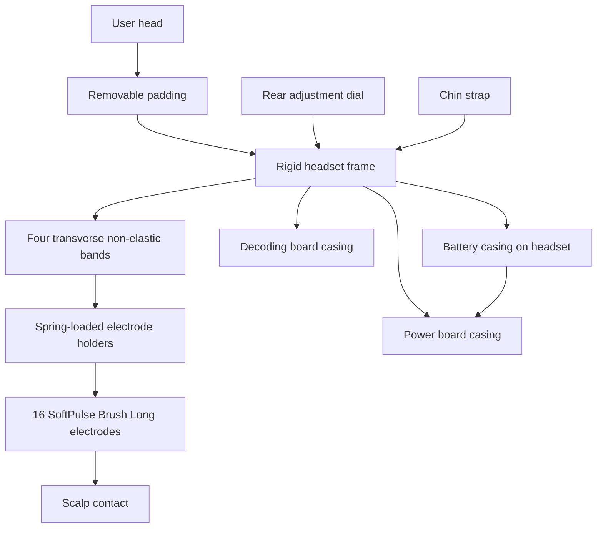
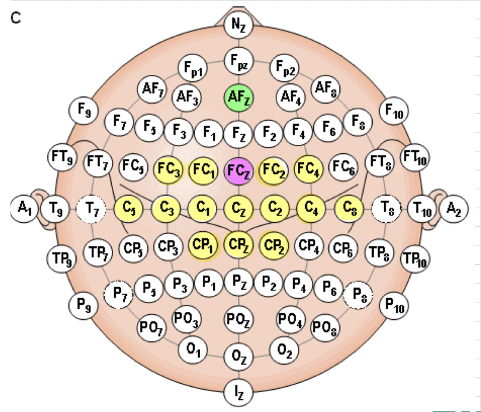

# Design Solution Definition: EEG/Headset

> **Project:** N-pulse – Wearable EEG System for Prosthetic Control
> **Document ID:** `DSD-EEG-HD-001`
> **Version:** `0.1.0` **Status:** `Draft`
> **Project phase:** `pre-System Design Review`
> **Last modified:** `2026-10-26`
> **Repository path:** `docs/DSD-HEADSET.md`

---

## Document control

### Roles and sign-off

| Role | Name | Affiliation / Handle | Date | Signature / Review link |
|---|---|---|---|---|
| Author(s) | Yassin Elaraby | Headset Designer | @Yassin-elaraby | |
| Reviewer (technical) | Maëlys Clerget | N-pulse — EEG Team Leader | @maelysclerget | |
| Concurrence (SE Reviewer) | Luca Seelbach & Santiago Ramos | N-pulse — System Engineers | | |
| Concurrence (Quality management reviewer) | Armelle Chritin | N-pulse — Quality Management | | |
| Approval (Project Manager) | Elodie Dubois | N-pulse — Project Manager | | |

> Note: Link approval to any relevant pull request (PR).

### Modification log

| Version | Date | Author(s) | Main changes | PR / Commit |
|---|---|---|---|---|
| | 2026-10-24 | Yassin Elaraby | Initial headset DSD draft | |
| 0.1.0 | 2026-10-26 | Yassin Elaraby | Addressed review comments and documented the current prototype design and measured masses | PR #2 |

---

## Table of contents

1. [Introduction](#1-introduction)
2. [Requirements and traceability](#2-requirements-and-traceability)
3. [Concept justification](#3-concept-justification)
4. [Traded-off concepts](#4-traded-off-concepts)
5. [Quality management and compliance](#5-quality-management-and-compliance) /!\ THIS SECTION IS NOT FINALISED /!\
6. [Licensing](#6-licensing) /!\ THIS SECTION IS NOT FINALISED /!\
7. [Open issues and future work](#7-open-issues-and-future-work)
8. [References](#8-references)
9. [Appendices](#9-appendices)

---

## 1. Introduction

### 1.1 Purpose and scope

This Design Solution Definition (DSD) is at a `Prototype` stage validated on `<date>`. It justifies the concept selected for `Headset mechanical Design`. 

It covers:

- the headset frame and adjustment concept
- the non-elastic electrode bands and their frame interfaces
- the electrode layout and holder concept
- the rear dial, chin strap, and removable padding
- the mechanical integration of the power-board and decoding-board casings
- the integration of the battery casing on the headset
- the previous concepts considered and the reasons for retaining the current hybrid concept.

**Out of scope:** `EEG signal acquisition and processing (EEG Board DSD); EEG Power Board (Power Board DSD).`

### 1.2 Responsibility and change authority

- **Document owner:** `Yassin Elaraby, Headset Designer / @Yassin-elaraby`
- **Change authority:** `EEG Team Leader and System Engineer Electronics, subject to project review and approval procedures`

### 1.3 Abbreviated terms and definitions

| Term | Definition |
|---|---|
| DSD | Design Solution Definition |
| EEG | Electroencephalography |
| PETG | Polyethylene terephthalate glycol-modified |
| PA12 | Polyamide 12 (Nylon 12) |
| PCB | Printed circuit board |
| STEP | Standard for the Exchange of Product model data |
| REF | Reference electrode used as the reference potential for the EEG measurement channels |
| BIAS | Driven-bias electrode used to control common-mode voltage and improve common-mode noise rejection |

## 2. Requirements and traceability

| Requirement ID | Requirement | Acceptance criteria | Verification method | Status |
|---|---|---|---|---|
| EEG-002 | The EEG headset subsystem shall simultaneously acquire at least 16 distinct EEG channels. | At least 16 dry comb EEG channels simultaneously active and continuously acquiring. | T, I | Electrode layout defined – headset assembly and system testing pending |
| EEG-008 | The EEG headset shall ensure patient ESD protection. | ±8 kV contact, ±14 kV air. | T | ESD compliance testing pending |
| EEG-010 | The EEG headset shall not exceed 41°C on skin contact. | ≤ 41°C on every skin-contact surface, in normal and single-fault conditions. | T, M | Skin temperature testing pending |

> **Verification methods:** (D)emonstration, (T)est, (M)easurement, (I)nspection, (A)nalysis.
> 
> **EEG-008 and EEG-010** are shared system-level requirements. The Headset DSD addresses their mechanical implications, while electrical protection and verification are coordinated with the EEG electronics team.
---

## 3. Concept justification

### 3.1 Solution overview

The retained concept combines rigid and adaptable elements to provide a stable, adjustable, and comfortable EEG headset while maintaining reliable electrode–scalp contact. A rigid 3D-printed frame supports four removable transverse non-elastic bands that account for local head curvature and carry spring-loaded electrode holders. A rear adjustment dial, chin strap, and removable padding improve fit and stability. The headset also accommodates electrode-mounted buffer PCBs and two rear PETG enclosures for the power and EEG acquisition boards. For the current prototype, the battery will be mounted on the headset. 

*Figure 3.1: Mechanical architecture and planned subsystem integration.*

### 3.2 Main design choices

#### 3.2.1 Rigid frame with rear adjustment

- **Decision:** Use a rigid 3D-printed frame, opened at the rear into a horseshoe form and bridged by a rear adjustment dial.
- **Rationale:** The rigid frame provides a stable reference for the electrode bands and electronics, limiting unwanted displacement of the electrodes during use. Compared with a fully flexible frame, it is intended to improve positional repeatability, while the rear adjustment dial allows the headset to accommodate different head sizes without requiring multiple frame dimensions.
- **Design objective addressed:** Adaptability to different head sizes through the rear-adjustment mechanism. This objective does not yet have a formally assigned requirement ID.
- **Consequences / limitations:** The rear dial provides 90 mm of mechanism travel, or ±45 mm from its midpoint. Dimensional validation is pending until the purchased mechanism is delivered and measured. Its mounting geometry, effective headset adjustment range, attachment loads, and effect on frame deformation must then be validated. PETG cracking during adjustment remains a known concern.

#### 3.2.2 Transverse non-elastic electrode bands

- **Decision:** Use four transverse non-elastic bands to support the 16 electrodes, including the measurement, REF, and BIAS electrodes. The frame will have four physical band slots on each side, eight slots in total.
- **Rationale:** The bands account for local head curvature while the rigid frame provides the main positional reference. Fixed frame slots constrain the position of each band, reducing unwanted movement of the electrode rows compared with the previous flexible design. Removable bands also facilitate assembly, adjustment, and replacement.
- **Requirements addressed:** 
- **Consequences / limitations:** Four bands are required, but their product, material, width, thickness, and supplier have not yet been selected. Selection and finalization of the eight slot dimensions and locations are planned for the week of 26 October 2026.

#### 3.2.3 Electrode layout and holders

- **Decision:** Use 16 Datwyler SoftPulse Brush Long dry electrodes at the confirmed 10–10 positions. Each electrode holder is intended to fit within a maximum external footprint of 28 × 28 mm, including its attachment features. The proposed electrode connection uses a Rome Fastener No. 11 segmented spring socket. The electrode connects to the socket, which connects directly to the buffer. The socket and buffer are contained within the spring-loaded holder and move with the electrode during compression.
- **Rationale:** The selected electrode layout concentrates the measurement electrodes around the sensorimotor regions relevant to the intended application while including dedicated REF and BIAS electrodes. Spring-loaded holders are intended to compensate for local differences in scalp curvature and hair thickness, maintaining electrode–scalp contact while limiting excessive pressure. Integrating the buffer directly with the electrode reduces the length of the unbuffered signal path and its susceptibility to noise and motion artefacts.
- **Requirements addressed:** EEG-002
- **Consequences / limitations:** Use of the proposed socket still requires approval. Final holder height, spring type, stiffness, preload, travel, and internal clearances cannot be finalized until the connector is approved and the buffer thickness is known. The 28 × 28 mm target footprint will be retained where possible. The holder design is expected to be completed within a few days after connector approval and confirmation of the buffer thickness.
  
| Function | Electrode positions | Count |
|---|---|---:|
| Front measurement row | FC3, FC1, FC2, FC4 | 4 |
| Central measurement row | C5, C3, C1, Cz, C2, C4, C6 | 7 |
| Rear measurement row | CP1, CPz, CP2 | 3 |
| Reference | FCz | 1 |
| BIAS | AFz | 1 |
| **Total** | **14 measurement + reference + BIAS** | **16** |

#### 3.2.4 Stability and comfort features

- **Decision:** Add a chin strap and removable internal padding.
- **Rationale:** The chin strap is intended to limit headset movement during use, helping maintain stable electrode positioning and contact with the scalp. Removable padding allows local fit and comfort adjustments by reducing pressure points between the rigid frame and the head.
- **Requirements addressed:** 
- **Consequences / limitations:** Dimensional validation of the chin strap is pending until the purchased strap is delivered and measured. Its attachment-slit dimensions and locations will then be finalized in the headset CAD. Lumos Ultra helmet padding is being considered; its quantity, attachment method, thickness, and positions remain to be finalized. The headset's complete comfort and stability have not yet been validated.

#### 3.2.5 Electronics and battery integration

- **Decision:** Mount two separate PETG enclosures on the back of the headset: one for the power board and one for the EEG decoding board. Mount the battery on the headset in a separate casing.
- **Rationale:** Separate enclosures allow the boards to be mounted and accessed independently, facilitating assembly and maintenance. Integrating the battery onto the headset provides a self-contained system without an external power cable.
- **Requirements addressed:**
- **Consequences / limitations:** The current board enclosures are first prototypes intended to evaluate dimensions and mechanical integration. PCB supports, connector openings, fasteners, and cable-routing features require validation against the complete board assemblies. The battery casing must be securely mounted, and its impact on weight distribution, comfort, and headset stability must be evaluated.

#### 3.2.6 Material and manufacturing

- **Decision:** Use 3D-printed PETG for the current headset-frame and enclosure prototypes.
- **Rationale:** PETG enables low-cost and rapid design iterations during prototyping. Its toughness and flexibility compared with more brittle printing materials make it suitable for evaluating the adjustable frame geometry and mechanical attachments.
- **Requirements addressed:** NONE
- **Consequences / limitations:** No mechanical durability testing has yet been performed. The PETG prototype will be tested experimentally through headset adjustment, assembly, and repeated-use testing after the complete prototype is available. Particular attention will be given to the rear-dial interface, band slots, and enclosure mounts. PA12 remains a possible future material if PETG testing identifies durability limitations after the geometry has stabilized.

### 3.3 Current dimensions

#### 3.3.1 Head measurements used for initial sizing

| Measurement | Current value | Status |
|---|---:|---|
| Front-to-back over the scalp | 370 mm | Measured; anatomical landmarks not documented |
| Ear-to-ear over the scalp | 375 mm | Measured; anatomical landmarks not documented |
| Head circumference | Approximately 575–580 mm | Initial reference; initial frame fit has been tested, but the complete adjustment range requires validation |
| Rear-dial mechanism travel | 90 mm total (±45 mm) | Mechanism travel defined; dimensional validation pending after delivery and measurement |

#### 3.3.2 Current frame STEP model

The values below were measured from the current [`frame design.step`](../headset/cad/frame%20design.step) export. They describe the unmodified model and do not prove fit after adding padding, the rear opening, or the dial.

| Property | Value |
|---|---:|
| Overall front-to-back extent | 237.73 mm |
| Overall lateral width | 182.60 mm |
| Maximum vertical extent | 50.47 mm |
| Inner perimeter at the flat top | 590.83 mm |
| Outer perimeter at the flat top | 652.26 mm |
| Recorded CAD volume | 146.87 cm³ |

A nominal PETG density of 1.27 g/cm³ gives a theoretical fully solid mass of approximately 186.5 g for the recorded CAD volume. The current frame was printed with 10% infill and has a measured mass of **73 g**. The infill percentage cannot be applied directly to the fully solid mass because the outer walls, top and bottom layers, and thin structural features are printed as solid material. The measured value is therefore used as the current mass reference.

#### 3.3.3 Known component envelopes

| Component | Current dimensions | Notes |
|---|---:|---|
| Complete electrode holder | Target footprint: 28 × 28 mm | Includes attachment features. Final height and spring compression range require the connector decision and buffer thickness. |
| Datwyler SoftPulse Brush Long electrode | 13 mm diameter | Selected electrode; mechanical fit requires an assembly test. |
| Buffer PCB | 22 mm diameter | Intended to move with the electrode in the spring-loaded holder. Thickness still required. |
| Power board | 65 × 60 mm | PCB footprint defined. Complete board height and connector details are not yet known. |
| Power-board enclosure | 71 × 66 × 26 mm body; 67 × 62 × 24 mm cavity; 83 × 66 mm overall footprint with tabs; 28 mm closed height | First PETG prototype with 2 mm walls, floor, and lid. Validation requires the complete board assembly. |
| EEG decoding board | 45 × 85 mm | PCB footprint defined. Complete board height and connector details are not yet known. |
| Decoding-board enclosure | 91 × 51 × 26 mm body; 87 × 47 × 24 mm cavity; 103 × 51 mm overall footprint with tabs; 28 mm closed height | First PETG prototype with 2 mm walls, floor, and lid. Validation requires the complete board assembly. |
| Battery | 69 × 37 × 19 mm | Battery casing designed; integration onto the headset frame and mechanical attachment to be verified. |

#### 3.3.4 Prototype enclosure details and measured masses

Both prototype electronics enclosures use PETG with 2 mm walls, floor, and lid. The power-board enclosure measures 71 × 66 × 26 mm and contains a 67 × 62 × 24 mm cavity. The decoding-board enclosure measures 91 × 51 × 26 mm and contains an 87 × 47 × 24 mm cavity.

Each enclosure has two external mounting tabs measuring 8 × 8 × 26 mm. The lids are secured using M1.6 × 5 mm screws and M1.6 × 2.5 mm heat-set inserts installed in Ø2.2 × 4 mm-deep holes. The closed enclosure height is 28 mm, excluding screw heads. Overall footprints including the tabs are 83 × 66 mm for the power-board enclosure and 103 × 51 mm for the decoding-board enclosure.

Each lid includes a 1.2 mm-thick, 2 mm-deep locating lip with 0.3 mm clearance per side. PCB supports and connector openings remain provisional and require validation against the complete board assemblies.

| Printed PETG part | Measured mass |
|---|---:|
| Headset frame, printed at 10% infill | 73.0 g |
| Power-board enclosure and lid | 40.0 g |
| Decoding-board enclosure and lid | 40.5 g |
| **Measured PETG subtotal** | **153.5 g** |

The subtotal excludes the electrodes, holders, springs, buffer PCBs, circuit boards, rear dial, chin strap, padding, fasteners, wiring, battery, and battery casing. The final assembled headset mass therefore still requires measurement.

### 3.4 Functionally linked systems

| Linked system | Headset interface | Integration status |
|---|---|---|
| EEG electrodes and buffer PCBs | Electrode holders, spring-loaded mechanism, socket connection, and cable routing to the EEG board | Electrode and buffer PCB footprints defined; connector approval, buffer thickness, mechanical fit, and spring movement require validation |
| EEG decoding board | Rear enclosure, mounting mechanism, and connections to the electrode buffer PCBs | First enclosure designed; physical validation pending availability of the complete board |
| Power board | Rear enclosure, mounting mechanism, and electrical connections to the EEG board and battery | First enclosure designed; physical validation pending availability of the complete board |
| Battery and casing | Mechanical attachment to the headset frame, battery retention, and electrical connection to the Power Board | Battery casing designed; mounting, cable routing, and impact on headset stability remain to be validated |
| User | Frame adjustment, chin strap, padding, and electrode–scalp contact | Initial frame fit tested; complete fit, comfort, stability, and contact validation pending integration of the remaining components |

### 3.5 Current prototype status

Completed or agreed work:

- Compared the previous flexible and rigid headset concepts.
- Retained the hybrid rigid-frame and transverse-band concept.
- Created the current Fusion 360 frame model and exported it as STEP.
- Performed an initial fit test of the headset frame.
- Defined the 16 electrode positions: 14 measurement electrodes, one REF (FCz), and one BIAS (AFz).
- Selected the Datwyler SoftPulse Brush Long dry electrodes.
- Selected the spring-loaded electrode-holder concept and defined a target external footprint of 28 × 28 mm.
- Proposed the Rome Fastener No. 11 socket for the electrode-to-buffer connection; approval remains pending.
- Defined four transverse non-elastic bands and eight frame slots.
- Selected and ordered the rear adjustment dial and chin strap; dimensional validation is pending delivery and measurement.
- Designed first-prototype PETG enclosures for the power board and EEG decoding board.
- Designed a battery casing for integration onto the headset; mechanical mounting and validation remain in progress.

## 4. Traded-off concepts

### 4.1 Trade-off method

The comparison is qualitative at this stage. No numerical scores or weights have been assigned. The concepts were compared using the following considerations:

- adaptability to different head sizes and shapes
- electrode-position repeatability
- stability on the head
- expected comfort and pressure distribution
- compatibility with the selected electrode arrangement
- integration of electronics and adjustment components
- ease of prototyping and future modification.

Particular attention was given to maintaining stable electrode positioning while accommodating variations in head shape and ensuring user comfort. The retained concept was selected based on the advantages and limitations identified during the development of the previous prototypes.

### 4.2 Flexible cap
The flexible-cap concept was developed by the previous year's N-pulse team. It featured an adjustable frame and flexible electrode-support bands, allowing the electrode holders and rows to be repositioned.

**Pros**

- Adjustable head frame
- Flexible bands that accommodate variations in scalp shape
- Simple design
- Adjustable positions for electrode holders and rows

**Cons**

- Limited stability on the head
- Difficult to achieve consistent electrode positioning between uses
- Electrode rails can move, potentially affecting electrode contact and positional repeatability

**Decision:** Not retained as the complete headset architecture due to limitations in stability and electrode-position repeatability. However, the flexible electrode-support bands are retained in the hybrid design to accommodate local variations in head shape.

### 4.3 Rigid cap

The rigid-cap concept was also developed by the previous year's N-pulse team. It featured a rigid frame with predefined electrode positions, spring-loaded electrode holders, a rear adjustment dial, and a forehead-mounted battery.

**Pros**

- Fixed electrode positions, providing a more repeatable electrode layout
- Spring-loaded electrode mounting system to accommodate local variations in scalp curvature
- Rear dial for head-size adjustment
- Rigid structure providing stable support for electrodes and electronic components

**Cons**

- Limited adaptability to individual scalp curvature due to the rigid frame
- Rigid frame can create localized pressure points, reducing comfort
- Forehead-mounted battery increases the weight supported by the head and may cause discomfort
- Wiring across the frame complicates cable routing and may introduce mechanical constraints during adjustment

**Decision:** Not retained unchanged due to its limitations in comfort and weight distribution. The rigid frame, rear adjustment mechanism, and spring-loaded electrode holders are retained in the hybrid design, while elastic bands provide additional adaptability and the battery is moved off the head.

### 4.4 Wearable Sensing DSI-24 concept

The DSI-24 uses a compact, flexible structure designed to accommodate different head shapes. It was considered as design inspiration because of its adaptability and electrode-support mechanism. However, its existing structure and electrode distribution do not directly match the selected 16-electrode montage. Adapting this concept would therefore require substantial modifications to the electrode-support geometry.

**Decision:** Not retained as the headset architecture, but considered as a reference for mechanical adaptability and electrode positioning.

- [Wearable Sensing DSI-24](https://wearablesensing.com/dsi-24/)
- [Project notes on the DSI-24](https://app.notion.com/p/EEG-headset-information-1b2e4f65ffef8061a763f2f43d6580ea?pvs=21)

### 4.5 Battery placement trade-off

Two battery placement options were considered:

**Headset-mounted battery**
- **Pros:** Self-contained system, shorter power cables, and no external battery attachment required.
- **Cons:** Additional weight on the head, requiring careful consideration of weight distribution, comfort, and mechanical stability.

**External battery armband**
- **Pros:** Reduces the weight supported by the head.
- **Cons:** Requires an external cable between the battery and headset, with additional constraints on cable routing, strain relief, and user movement.

**Decision:** The headset-mounted battery was retained for the current prototype. The external armband was considered as an alternative but was not validated. The impact of the retained configuration on comfort, weight distribution, and mechanical stability remains to be evaluated.

### 4.6 Retained hybrid concept

The retained design combines the most useful features of the flexible and rigid concepts developed by the previous year's N-pulse team, while addressing their identified limitations. It aims to maintain consistent electrode positioning while accommodating differences in head shape and improving comfort.

**Retained features**

- Rigid frame for electrode positioning and component mounting
- Four transverse elastic bands to accommodate local variations in head shape
- Fixed band slots to limit electrode-row movement
- Spring-loaded electrode holders to maintain electrode–scalp contact
- Rear-dial adjustment to accommodate different head sizes
- Chin strap and removable padding to improve stability and comfort
- Separate rear casings for the Power Board and EEG decoding board
- Battery mounted on the headset in a separate casing
- 
**Current limitations**

- Complete headset assembly has not yet been built or validated
- Effective adjustment range, electrode-position repeatability, comfort, and stability remain to be tested
- Spring stiffness and compression range still need to be determined to achieve the target electrode contact force
- Mechanical integration of the rear dial, chin strap, padding, elastic bands, and electronics casings is still being finalized
- Total assembled headset mass has not yet been measured
- Battery mounting and its impact on weight distribution, comfort, and stability remain to be validated.

## 5. Quality management and compliance

**WORK IN PROGRESS**
<!--
<!-- Adapt to your regulatory context. If the project is RUO-only, say so and
explain which parts apply by choice (good practice) versus by obligation. 

### 5.1 Regulatory classification and pathway

| Item | Statement |
|---|---|
| Intended use classification | `<RUO / IVD / medical device / bioprocess / environmental / other>` |
| Target jurisdictions | `<EU / US / CH / UK / other>` |
| Applicable regulation | `<e.g. EU IVDR 2017/746, EU MDR 2017/745, FDA 21 CFR 820 (QMSR), 21 CFR Part 11>` |
| Device / product class | `<class and rationale>` |
| Regulatory strategy | `<summary, notified body / agency contact status>` |

### 5.2 Quality management system

- **QMS framework:** `<ISO 13485 / ISO 9001 / GLP / GMP / GCP / lightweight in-house QMS>`
- **QMS scope and document hierarchy:** `<link>`
- **Design controls followed:** `<design inputs → outputs → review → verification → validation → transfer → changes>`
- **This document's place in the design history file (DHF):** `<link>`

### 5.3 Applicable standards and guidelines

| Standard / Guideline | Title | Applicability | Compliance status |
|---|---|---|---|
| ISO 13485 | Medical devices: Quality management systems | | Planned / Partial / Compliant / N/A |
| ISO 14971 | Application of risk management to medical devices | | |
| IEC 62304 | Medical device software life cycle | | |
| IEC 61010-1 | Safety of electrical equipment for measurement, control, laboratory use | | |
| IEC 62366-1 | Usability engineering | | |
| ISO 20387 | Biobanking: general requirements | | |
| `<other>` | | | |

### 5.4 Ethics, access, and biosecurity compliance

| Topic | Applicability | Status / reference |
|---|---|---|
| Ethics committee / IRB approval | | |
| Informed consent | | |
| Nagoya Protocol / access and benefit sharing | | |
| Biosafety committee approval | | |
| Import / export / dual-use controls | | |
| Animal research regulations | | |

-->

## 6. Licensing

**WORK IN PROGRESS**

<!--
| Topic | Decision |
|---|---|
| Hardware license | `<CERN-OHL-S / CERN-OHL-W / TAPR / other>` |
| Software license | `<Apache-2.0 / GPL-3.0 / MIT / other>` |
| Documentation and data license | `<CC-BY-4.0 / CC0 / other>` |
| Open Source Hardware certification | `<OSHWA status>` |
| Licence compatibility of all dependencies | `<checked on YYYY-MM-DD, link to SBOM>` |
| Patents / IP / prior art | `<statement, defensive publication?>` |
| Contribution and governance model | `<link to CONTRIBUTING.md / GOVERNANCE.md>` |
| Liability and warranty disclaimer | `<statement, especially for any clinical use>` |
| Sourcing for builders | `<BOM with alternates, availability of parts worldwide>` |
| Quality of community-contributed changes | `<review gates, required tests, who can merge>` |

-->

## 7. Open issues and future work

| ID | Open issue / validation required | Owner | Target date or milestone | Impact if unresolved |
|---|---|---|---|---|
| OI-01 | Receive and measure the rear dial, then design and validate its frame attachments and rear opening. | Yassin Elaraby | After delivery; shipping date unknown | Fit range and frame loads cannot be validated |
| OI-02 | Approve the proposed electrode socket, confirm the buffer thickness, and select the holder spring, preload, travel, and total height. | Yassin Elaraby | Holder design within a few days after connector approval and confirmation of buffer thickness | Electrode contact and holder assembly remain incomplete |
| OI-03 | Select the four non-elastic bands and finalize the eight slot dimensions and locations. | Yassin Elaraby | Week of 2026-10-26 | Electrode rows cannot be assembled repeatably |
| OI-04 | Manufacture and validate the first power-board and decoding-board enclosures. | Yassin Elaraby | Physical validation when the complete boards are available | Full electronics assembly cannot be mounted or validated |
| OI-05 | Receive and measure the chin strap, then add suitable attachment slits to the CAD. | Yassin Elaraby | After delivery; shipping date unknown | Stability feature cannot be integrated |
| OI-06 | Select removable padding and define its quantity, attachment method, thickness, and locations. | Yassin Elaraby | Before complete comfort evaluation | Complete comfort evaluation cannot be performed |
| OI-07 | Integrate the battery casing onto the headset and validate its mechanical attachment, cable routing, weight distribution, and impact on comfort and stability. | Yassin Elaraby | Before complete headset validation | Battery integration and its impact on headset performance remain unvalidated |
| OI-08 | Complete the assembly and verify comfort, stability, electrode positional repeatability, and final mass. | Yassin Elaraby | Initial frame fit tested; remaining tests after dependent components are completed | Complete prototype performance remains unvalidated |
| OI-09 | Test frame thickness and PETG durability around the dial, slots, and enclosure mounts; consider PA12 only after geometry stabilizes. | Yassin Elaraby | Experimental testing after the complete prototype is assembled | Frame durability and final material remain uncertain |

---

## 8. References

1. [EEG headset design documentation and previous-design comparison](../headset/README.md)
2. [Current headset frame STEP model](../headset/cad/frame%20design.step)
3. [Datwyler SoftPulse products — SoftPulse Brush Long](https://datwyler.com/company/innovation/softpulse/products/)
4. [Selected rear adjustment dial](https://www.amazon.fr/dp/B0F7X6MM9G)
5. [Selected ABUS chin strap Scator(-E)](https://www.galaxus.ch/en/s4/product/abus-chin-strap-scator-e-work-safety-accessories-52403525)
6. [Fiedler et al., “Contact Pressure and Flexibility of Multipin Dry EEG Electrodes”](https://ieeexplore.ieee.org/document/8307253)
7. [Fiedler et al., “Flower electrodes for comfortable dry electroencephalography”](https://www.researchgate.net/publication/374418531_Flower_electrodes_for_comfortable_dry_electroencephalography)
8. [Portillo-Lara et al., “Mind the gap: State-of-the-art technologies and applications for EEG-based brain–computer interfaces”](https://www.researchgate.net/publication/353384603_Mind_the_gap_State-of-the-art_technologies_and_applications_for_EEG-based_brain-computer_interfaces)
9. [Chen et al., “Neural Correlates of Motor Recovery after Robot-Assisted Training in Chronic Stroke: A Multimodal Neuroimaging Study”](https://www.researchgate.net/publication/352291862_Neural_Correlates_of_Motor_Recovery_after_Robot-Assisted_Training_in_Chronic_Stroke_A_Multimodal_Neuroimaging_Study)
10. [Rome Fastener No. 11 segmented spring socket](https://www.romefast.com/Snap-Fasteners-Segmented-Spring-Five-Sixteenths-Inch.asp)
11. [Lumos Ultra helmet padding](https://www.galaxus.ch/en/s3/product/lumos-helmet-padding-ultra-bike-helmet-accessories-21117144)
12. [EPFL SPOT available 3D-printing materials](https://make.epfl.ch/wiki/public/spot_-_3d_printing/available_materials)

---

## 9. Appendices

### Appendix A: Electrode placement map

The highlighted map below was prepared by the project author and identifies the selected measurement, reference, and BIAS  positions.

- Yellow: 14 measurement electrodes
- Magenta: FCz reference
- Green: AFz BIAS 

### Appendix B: Current CAD files

| File | Description | Format | Units | Status |
|---|---|---|---|---|
| [`frame design.step`](../headset/cad/frame%20design.step) | Current headset-frame prototype exported from Fusion 360 | STEP AP214 | mm | Work in progress |
| [`frame test.step`](../headset/cad/frame%20test.step) | Additional headset-frame prototype export | STEP AP214 | mm | Work in progress |
| [`Power board box.step`](../headset/cad/Power%20board%20box.step) | Power-board enclosure body | STEP AP214 | mm | First prototype |
| [`Power board lid.step`](../headset/cad/Power%20board%20lid.step) | Power-board enclosure lid | STEP AP214 | mm | First prototype |
| [`Decoding box.step`](../headset/cad/Decoding%20box.step) | Decoding-board enclosure body | STEP AP214 | mm | First prototype |
| [`decoding lid.step`](../headset/cad/decoding%20lid.step) | Decoding-board enclosure lid | STEP AP214 | mm | First prototype |
| [`Battery box.step`](../headset/cad/Battery%20box.step) | Battery enclosure body | STEP AP214 | mm | Work in progress |
| [`battery lid.step`](../headset/cad/battery%20lid.step) | Battery enclosure lid | STEP AP214 | mm | Work in progress |

The complete headset assembly will be added when it is ready for repository review.

### Appendix C: Preliminary component list

| Component | Source | Quantity | Status |
|---|---|---:|---|
| 3D-printed headset frame | Project CAD | 1 | PETG prototype; measured mass 73 g at 10% infill |
| Transverse non-elastic bands |  | 4 | Product and dimensions not yet selected |
| Electrode holders | Project design | 16 | In progress |
| Rome Fastener No. 11 socket | Rome Fastener | 16 | Proposed; approval required |
| Datwyler SoftPulse Brush Long electrodes | Datwyler | 16 | Selected / purchased |
| Buffer PCBs | Project electronics | 16 | Purchased; thickness and holder integration require confirmation |
| Rear adjustment dial | Selected Amazon listing | 1 | Ordered; awaiting delivery and dimensional validation |
| Chin strap | ABUS Scator(-E) | 1 | Ordered; awaiting delivery and dimensional validation |
| Removable padding | Lumos Ultra candidate |  | Candidate under consideration |
| Power-board enclosure and lid | Project CAD | 1 | First PETG prototype; measured mass 40.0 g; STEP files available in `headset/cad/` |
| Decoding-board enclosure and lid | Project CAD | 1 | First PETG prototype; measured mass 40.5 g; STEP files available in `headset/cad/` |
| Battery casing | Project CAD | 1 | Designed; ventilation and cable opening planned; STEP files available in `headset/cad/` |
