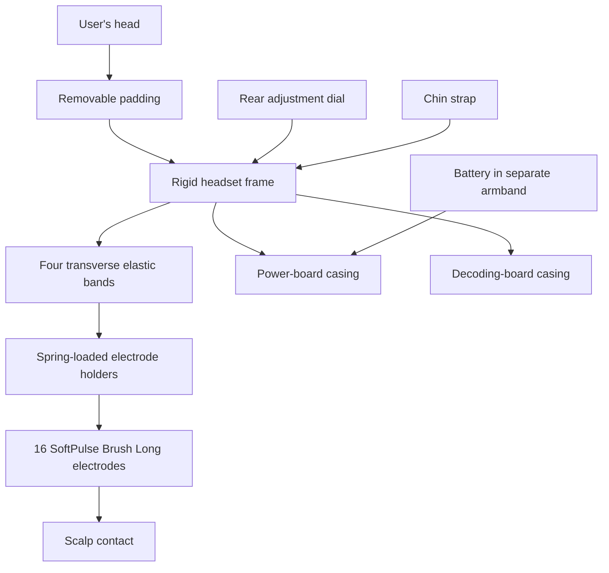

# Design Solution Definition: EEG/Headset

> **Project:** N-pulse – Wearable EEG System for Prosthetic Control
> **Document ID:** `DSD-EEG-HD-001`
> **Version:** `0.1.0` **Status:** `Draft`
> **Project phase:** `pre-System Design Review`
> **Last modified:** `2026-10-25`
> **Repository path:** `docs/DSD-HEADSET.md`

---

## Document control

### Roles and sign-off

| Role | Name | Affiliation / Handle | Date | Signature / Review link |
|---|---|---|---|---|
| Author(s) | Yassin Elaraby | Headset Designer | @Yassin-elaraby | | |
| Reviewer (technical) | Maëlys Clerget | N-pulse — EEG Team Leader | @maelysclerget | | |
| Concurrence (SE Reviewer) | Luca Seelbach & Santiago Ramos | N-pulse — System Engineers | | |
| Concurrence (Quality management reviewer) | Armelle Chritin | N-pulse — Quality Management | | |
| Approval (Project Manager) | Elodie Dubois | N-pulse — Project Manager | | |

> Note: Link approval to any relevant pull request (PR).

### Modification log

| Version | Date | Author(s) | Main changes | PR / Commit |
|---|---|---|---|---|
| | 2026-10-24 | Yassin Elaraby | Initial headset DSD draft | |

---

## Table of contents

1. [Introduction](#1-introduction)
2. [Requirements and traceability](#2-requirements-and-traceability)
3. [Concept justification](#3-concept-justification)
4. [Traded-off concepts](#4-traded-off-concepts)
5. [Quality management and compliance](#5-quality-management-and-compliance) /!\ THIS SECTION IS NOT FINALISED /!\
6. [Licensing](#6-licensing) /!\ THIS SECTION IS NOT FINALISED /!\
7. [Open issues and future work](#7-open-issues-and-future-work)
8. [References](#8-references)
9. [Appendices](#9-appendices)

---

## 1. Introduction

### 1.1 Purpose and scope

This Design Solution Definition (DSD) is at a `Prototype` stage validated on `<date>`. It justifies the concept selected for `Headset mechanical Design`. 

It covers:

- the headset frame and adjustment concept
- the elastic electrode bands and their frame interfaces
- the electrode layout and holder concept
- the rear dial, chin strap, and removable padding
- the mechanical integration of the power-board and decoding-board casings
- the separate battery armband
- the previous concepts considered and the reasons for retaining the current hybrid concept.

**Out of scope:** `EEG signal acquisition and processing (EEG Board DSD); EEG Power Board (Power Board DSD).`

### 1.2 Responsibility and change authority

- **Document owner:** `Yassin Elaraby, Headset Designer / @Yassin-elaraby` <!-- Who is responsible to keep this document up to date ? <!-- Who is responsible to keep this document up to date ? --> 
- **Change authority:** `EEG Team Leader and System Engineer Electronics, subject to project review and approval procedures` <!-- What is the role/responsibility of the person -->

### 1.3 Abbreviated terms and definitions

| Term | Definition |
|---|---|
| DSD | Design Solution Definition |
| EEG | Electroencephalography |
| PETG | Polyethylene terephthalate glycol-modified |
| PA12 | Polyamide 12 (Nylon 12) |
| PCB | Printed circuit board |
| STEP | Standard for the Exchange of Product model data |
| TBC | To be confirmed |

## 2. Requirements and traceability

| Requirement ID | Requirement | Acceptance criteria | Verification method | Status |
|---|---|---|---|---|
| EEG-002 | The EEG headset subsystem shall simultaneously acquire at least 16 distinct EEG channels. | At least 16 dry comb EEG channels simultaneously active and continuously acquiring. | T, I | Electrode layout defined – headset assembly and system testing pending |
| EEG-008 | The EEG headset shall ensure patient ESD protection. | ±8 kV contact, ±14 kV air. | T | ESD compliance testing pending |
| EEG-010 | The EEG headset shall not exceed 41°C on skin contact. | ≤ 41°C on every skin-contact surface, in normal and single-fault conditions. | T, M | Skin temperature testing pending |

> **Verification methods:** (D)emonstration, (T)est, (M)easurement, (I)nspection, (A)nalysis.
> 
> **EEG-008 and EEG-010** are shared system-level requirements. The Headset DSD addresses their mechanical implications, while electrical protection and verification are coordinated with the EEG electronics team.
---

## 3. Concept justification

### 3.1 Solution overview

The retained concept combines rigid and flexible elements to provide a stable, adjustable, and comfortable EEG headset while maintaining reliable electrode–scalp contact. A rigid 3D-printed frame supports four removable transverse elastic bands that adapt to different head shapes and carry spring-loaded electrode holders. A rear adjustment dial, chin strap, and removable padding improve fit and stability. The headset also accommodates electrode-mounted buffer PCBs and two rear casings for the power and EEG acquisition boards, while the battery is carried separately in an armband to reduce the weight on the head.

*Figure 3.1: Mechanical architecture and planned subsystem integration.*

### 3.2 Main design choices

#### 3.2.1 Rigid frame with rear adjustment

- **Decision:** Use a rigid 3D-printed frame, opened at the rear into a horseshoe form and bridged by a rear adjustment dial.
- **Rationale:** The rigid frame provides a stable reference for the electrode bands and electronics, limiting unwanted displacement of the electrodes during use. Compared with a fully flexible frame, it is intended to improve positional repeatability, while the rear adjustment dial allows the headset to accommodate different head sizes without requiring multiple frame dimensions.
- **Requirements addressed:** 
- **Consequences / limitations:** The rear dial provides 90 mm of mechanism travel (±45 mm), but the effective head-size adjustment range still needs to be verified once integrated into the frame. The mechanical attachment and frame resistance during repeated adjustment also require validation, particularly due to the risk of PETG cracking.

#### 3.2.2 Transverse elastic electrode bands

- **Decision:** Use four transverse elastic bands to support the 16 electrodes, including the measurement, REF, and BIAS electrodes. The frame will have four physical band slots on each side, eight slots in total.
- **Rationale:** Elastic bands can accommodate differences in scalp curvature and help maintain electrode contact without requiring a fully flexible headset structure. The fixed frame slots constrain the position of each band, reducing unwanted movement of the electrode rows and improving positional repeatability compared with the previous flexible design. The removable bands also facilitate assembly, adjustment, and replacement.
- **Requirements addressed:** 
- **Consequences / limitations:** Band material, width, thickness, stretch, and final slot dimensions are not yet selected. Slot locations and clearances have not been validated.

#### 3.2.3 Electrode layout and holders

- **Decision:** Use 16 Datwyler SoftPulse Brush Long dry electrodes at the confirmed 10–10 positions. Each electrode holder is designed to fit within a maximum external footprint of 28 × 28 mm, including its attachment features. The electrode is connected to its buffer PCB through the electrode connector, and both components are mounted together inside a spring-loaded carrier. 
The electrode is connected to its buffer PCB through the electrode connector, and both components are mounted together in a spring-loaded carrier, allowing them to move as a single unit during compression.
- **Rationale:** The selected electrode layout concentrates the measurement electrodes around the sensorimotor regions relevant to the intended application, while including dedicated reference and BIAS electrodes. The spring-loaded carriers are intended to compensate for local variations in scalp curvature and hair thickness, helping maintain electrode–scalp contact while limiting excessive pressure. Integrating the buffer PCB directly with the electrode also avoids an additional cable between the electrode and its buffer, reducing the length of the unbuffered signal path and its susceptibility to noise and motion artifacts.
- **Requirements addressed:** EEG-002
- **Consequences / limitations:** The spring stiffness and compression range still need to be determined to achieve the target electrode contact force. The proposed 28 × 28 mm holder footprint, accommodating the 13 mm electrode and 22 mm buffer PCB, must be verified to ensure that all 16 holders fit in their designated positions without interfering with each other.
  
| Function | Electrode positions | Count |
|---|---|---:|
| Front measurement row | FC3, FC1, FC2, FC4 | 4 |
| Central measurement row | C5, C3, C1, Cz, C2, C4, C6 | 7 |
| Rear measurement row | CP1, CPz, CP2 | 3 |
| Reference | FCz | 1 |
| BIAS | AFz | 1 |
| **Total** | **14 measurement + reference + BIAS** | **16** |

#### 3.2.4 Stability and comfort features

- **Decision:** Add a chin strap and removable internal padding, with the exact products and attachment geometry to be confirmed.
- **Rationale:** The chin strap is intended to limit headset movement during use, helping maintain stable electrode positioning and contact with the scalp. Removable padding allows local fit and comfort adjustments by reducing pressure points between the rigid frame and the head.
- **Requirements addressed:** 
- **Consequences / limitations:** The chin-strap attachment geometry will be finalized once the purchased strap has been measured. The padding material, thickness, and attachment positions still need to be selected. The headset's comfort and stability have not yet been validated through user testing.

#### 3.2.5 Electronics and battery integration

- **Decision:** Mount two separate casings on the back of the headset: one for the power board and one for the EEG decoding board. Carry the battery separately in a running-style armband.
- **Rationale:** Separate casings allow the two boards to be mounted and accessed independently, facilitating assembly and maintenance. Moving the battery off the headset reduces the weight carried by the head compared with the previous forehead-mounted battery concept, improving weight distribution and potentially reducing discomfort during prolonged use.
- **Requirements addressed:** NONE
- **Consequences / limitations:** Casing dimensions and attachment mechanisms are still being finalized. Cable routing and strain relief between the electronics, electrodes, and external battery must be verified to ensure that cable movement does not compromise headset stability. The selected armband must also be checked for compatibility with the battery dimensions and weight.

#### 3.2.6 Material and manufacturing

- **Decision:** Use 3D-printed PETG for the current headset-frame prototypes.
- **Rationale:** PETG enables low-cost and rapid design iterations during prototyping. Its toughness and flexibility compared with more brittle printing materials make it suitable for evaluating the adjustable frame geometry and mechanical attachments.
- **Requirements addressed:** NONE
- **Consequences / limitations:** PETG cracking during adjustment remains a concern and must be evaluated experimentally. Final material selection is not complete. SLS PA12 may be investigated for a later prototype, but it is not the selected production material. Frame thinning and local reinforcement also remain future investigations.

### 3.3 Current dimensions

#### 3.3.1 Head measurements used for initial sizing

| Measurement | Current value | Status |
|---|---:|---|
| Front-to-back over the scalp | 370 mm | Measured; anatomical landmarks not documented |
| Ear-to-ear over the scalp | 375 mm | Measured; anatomical landmarks not documented |
| Head circumference | Approximately 575–580 mm | Initial reference; headset fit range not yet validated |
| Rear-dial mechanism travel | 90 mm total (±45 mm) | Mechanism travel defined; effective headset adjustment range not yet validated |

#### 3.3.2 Current frame STEP model

The values below were measured from the current [`frame design.step`](../headset/cad/frame%20design.step) export. They describe the unmodified model and do not prove fit after adding padding, the rear opening, or the dial.

| Property | Value |
|---|---:|
| Overall front-to-back extent | 237.73 mm |
| Overall lateral width | 182.60 mm |
| Maximum vertical extent | 50.47 mm |
| Inner perimeter at the flat top | 590.83 mm |
| Outer perimeter at the flat top | 652.26 mm |
| Solid material volume | 146.87 cm³ |

#### 3.3.3 Known component envelopes

| Component | Current dimensions | Notes |
|---|---:|---|
| Complete electrode holder | 28 × 28 mm | Target external footprint, including attachment features. Final height and spring compression range to be determined based on the target contact force. |
| Datwyler SoftPulse Brush Long electrode | 13 mm diameter | Selected electrode. Verify mechanical fit and secure attachment to the holder through an assembly test. |
| Buffer PCB | 22 mm diameter | Moves with the electrode in the spring-loaded holder.|
| Power board | 65 × 60 mm | PCB dimensions defined; casing dimensions to be finalized based on board height, connectors, wall thickness, and mounting features. Verify using CAD assembly checks and a physical fit test. |
| EEG decoding board | 45 × 85 mm | PCB dimensions defined; casing dimensions to be finalized based on board height, connectors, wall thickness, and mounting features. Verify using CAD assembly checks and a physical fit test. |
| Battery | 69 × 37 × 19 mm | Battery dimensions defined; verify fit and retention in the selected armband through a physical fit and movement test, including cable strain relief. |

### 3.4 Functionally linked systems

| Linked system | Headset interface | Integration status |
|---|---|---|
| EEG electrodes and buffer PCBs | Electrode holders, spring-loaded mechanism, mechanical attachment, and cable routing to the EEG board | Electrode and buffer PCB dimensions defined; mechanical fit and spring movement to be verified |
| EEG decoding board | Rear casing, mounting mechanism, and connections to the electrode buffer PCBs | PCB dimensions defined; casing integration and mounting to be verified |
| Power board | Rear casing, mounting mechanism, and electrical connections to the EEG board and battery | PCB dimensions defined; casing integration and mounting to be verified |
| Battery and armband | Off-head battery attachment and cable connection to the headset electronics | Armband concept selected; battery retention and cable strain relief to be verified |
| User | Frame adjustment, chin strap, padding, and electrode–scalp contact | Adjustment mechanism defined; fit, comfort, and electrode contact force to be validated |

### 3.5 Current prototype status

Completed or agreed work:

- Compared the previous flexible and rigid headset concepts.
- Retained the hybrid rigid-frame and elastic-band concept.
- Created the current Fusion 360 frame model and exported it as STEP.
- Defined the 16 electrode positions: 14 measurement electrodes, one REF (FCz), and one BIAS (AFz).
- Selected the Datwyler SoftPulse Brush Long dry electrodes.
- Selected the spring-loaded electrode-holder concept and defined a target external footprint of 28 × 28 mm.
- Defined four transverse elastic bands and eight frame slots.
- Selected the rear adjustment dial and chin strap for mechanical integration.
- Decided to use two separate rear casings for the Power Board and EEG decoding board, with the battery carried separately in an armband.
---

## 4. Traded-off concepts

### 4.1 Trade-off method

The comparison is qualitative at this stage. No numerical scores or weights have been assigned. The concepts were compared using the following considerations:

- adaptability to different head sizes and shapes
- electrode-position repeatability
- stability on the head
- expected comfort and pressure distribution
- compatibility with the selected electrode arrangement
- integration of electronics and adjustment components
- ease of prototyping and future modification.

### 4.2 Flexible cap

**Pros**

- Adjustable head frame
- Flexible band for electrode holders
- Simple design
- Adjustable positions for electrode holders and rows

**Cons**

- Not very stable
- Difficult to position consistently on the head
- Electrode rails can move

**Decision:** Not retained as the complete headset architecture. The useful idea of flexible electrode-support bands is carried into the new hybrid design.

### 4.3 Rigid cap

**Pros**

- Known electrode positions
- Spring-loaded electrode mounting system
- Rear dial for size adjustment
- Adapts to different head shapes through rear-dial adjustment

**Cons**

- Can create pressure points
- Forehead-mounted battery makes the headset uncomfortable
- Wires run across the complete structure

**Decision:** Not retained unchanged. The rigid positional reference, rear adjustment, and spring-loaded holders are carried into the new hybrid design, while the battery is moved off the head.

### 4.4 Wearable Sensing DSI-24 concept

The DSI-24 uses a compact umbrella-like structure that can adapt to different head shapes. It was considered as design inspiration but was not retained because its structure does not match the required electrode arrangement.

- [Wearable Sensing DSI-24](https://wearablesensing.com/dsi-24/)
- [Project notes on the DSI-24](https://app.notion.com/p/EEG-headset-information-1b2e4f65ffef8061a763f2f43d6580ea?pvs=21)

### 4.5 Retained hybrid concept

The retained design combines the most useful features of the previous flexible and rigid concepts.

**Retained features**

- a rigid frame for positional reference and component mounting
- transverse elastic bands to adapt locally to head shape
- fixed band slots to reduce row movement
- spring-loaded electrode holders
- rear-dial adjustment
- chin strap and removable padding
- separate rear board casings
- battery carried away from the head.

**Current limitations**

- complete assembly is not yet available
- fit range, electrode repeatability, comfort, and stability are not validated
- rear-dial, strap, padding, casing, band-slot, and spring details remain in progress
- total mass is TBC.

### 4.6 Trade-off summary

| Option | Retained | Main conclusion |
|---|---|---|
| Flexible cap | No | Adaptable and simple, but insufficiently stable and repeatable |
| Rigid cap | No | Stable positional reference, but pressure points and forehead battery reduce comfort |
| DSI-24-inspired structure | No | Adaptable and compact, but incompatible with the required electrode arrangement |
| Current hybrid concept | Yes | Best current trade-off between positional reference, local adaptability, modularity, and planned comfort improvements |

## 5. Quality management and compliance

**WORK IN PROGRESS**
<!--
<!-- Adapt to your regulatory context. If the project is RUO-only, say so and
explain which parts apply by choice (good practice) versus by obligation. 

### 5.1 Regulatory classification and pathway

| Item | Statement |
|---|---|
| Intended use classification | `<RUO / IVD / medical device / bioprocess / environmental / other>` |
| Target jurisdictions | `<EU / US / CH / UK / other>` |
| Applicable regulation | `<e.g. EU IVDR 2017/746, EU MDR 2017/745, FDA 21 CFR 820 (QMSR), 21 CFR Part 11>` |
| Device / product class | `<class and rationale>` |
| Regulatory strategy | `<summary, notified body / agency contact status>` |

### 5.2 Quality management system

- **QMS framework:** `<ISO 13485 / ISO 9001 / GLP / GMP / GCP / lightweight in-house QMS>`
- **QMS scope and document hierarchy:** `<link>`
- **Design controls followed:** `<design inputs → outputs → review → verification → validation → transfer → changes>`
- **This document's place in the design history file (DHF):** `<link>`

### 5.3 Applicable standards and guidelines

| Standard / Guideline | Title | Applicability | Compliance status |
|---|---|---|---|
| ISO 13485 | Medical devices: Quality management systems | | Planned / Partial / Compliant / N/A |
| ISO 14971 | Application of risk management to medical devices | | |
| IEC 62304 | Medical device software life cycle | | |
| IEC 61010-1 | Safety of electrical equipment for measurement, control, laboratory use | | |
| IEC 62366-1 | Usability engineering | | |
| ISO 20387 | Biobanking: general requirements | | |
| `<other>` | | | |

### 5.4 Ethics, access, and biosecurity compliance

| Topic | Applicability | Status / reference |
|---|---|---|
| Ethics committee / IRB approval | | |
| Informed consent | | |
| Nagoya Protocol / access and benefit sharing | | |
| Biosafety committee approval | | |
| Import / export / dual-use controls | | |
| Animal research regulations | | |

-->

## 6. Licensing

**WORK IN PROGRESS**

<!--
| Topic | Decision |
|---|---|
| Hardware license | `<CERN-OHL-S / CERN-OHL-W / TAPR / other>` |
| Software license | `<Apache-2.0 / GPL-3.0 / MIT / other>` |
| Documentation and data license | `<CC-BY-4.0 / CC0 / other>` |
| Open Source Hardware certification | `<OSHWA status>` |
| Licence compatibility of all dependencies | `<checked on YYYY-MM-DD, link to SBOM>` |
| Patents / IP / prior art | `<statement, defensive publication?>` |
| Contribution and governance model | `<link to CONTRIBUTING.md / GOVERNANCE.md>` |
| Liability and warranty disclaimer | `<statement, especially for any clinical use>` |
| Sourcing for builders | `<BOM with alternates, availability of parts worldwide>` |
| Quality of community-contributed changes | `<review gates, required tests, who can merge>` |

-->

## 7. Open issues and future work

| ID | Issue / TBD / TBC | Owner | Due | Impact if unresolved |
|---|---|---|---|---|
| OI-01 | Receive and measure the rear dial, then design and validate its frame attachments and rear opening. | Yassin Elaraby | TBC | Fit range and frame loads cannot be validated |
| OI-02 | Confirm electrode-buffer connection details and select the holder spring, preload, travel, and total height. | Yassin Elaraby | TBC | Electrode contact and holder assembly remain incomplete |
| OI-03 | Select the elastic bands and finalize the eight slot dimensions and locations. | Yassin Elaraby | TBC | Electrode rows cannot be assembled repeatably |
| OI-04 | Complete and integrate the power-board and decoding-board casings on the rear frame. | Yassin Elaraby | TBC | Full electronics assembly cannot be mounted |
| OI-05 | Receive and measure the chin strap, then add suitable attachment slits to the CAD. | Yassin Elaraby | TBC | Stability feature cannot be integrated |
| OI-06 | Select removable padding and define its attachment locations and thicknesses. | Yassin Elaraby | TBC | Comfort and fit cannot be evaluated completely |
| OI-07 | Select the battery armband and define safe cable routing and strain relief. | Yassin Elaraby | TBC | Off-head battery integration remains incomplete |
| OI-08 | Complete the assembly and verify fit, comfort, stability, electrode positional repeatability, and total mass. | Yassin Elaraby | TBC | Prototype performance remains unvalidated |
| OI-09 | Investigate frame thickness and PETG durability around the dial, slots, and casing mounts; consider PA12 only after geometry stabilizes. | Yassin Elaraby | TBC | Frame durability and final material remain uncertain |

---

## 8. References

1. [EEG headset design documentation and previous-design comparison](../headset/README.md)
2. [Current headset frame STEP model](../headset/cad/frame%20design.step)
3. [Datwyler SoftPulse products — SoftPulse Brush Long](https://datwyler.com/company/innovation/softpulse/products/)
4. [Selected rear adjustment dial](https://www.amazon.fr/dp/B0F7X6MM9G)
5. [Selected ABUS chin strap Scator(-E)](https://www.galaxus.ch/en/s4/product/abus-chin-strap-scator-e-work-safety-accessories-52403525)
6. [Fiedler et al., “Contact Pressure and Flexibility of Multipin Dry EEG Electrodes”](https://ieeexplore.ieee.org/document/8307253)
7. [Fiedler et al., “Flower electrodes for comfortable dry electroencephalography”](https://www.researchgate.net/publication/374418531_Flower_electrodes_for_comfortable_dry_electroencephalography)
8. [Portillo-Lara et al., “Mind the gap: State-of-the-art technologies and applications for EEG-based brain–computer interfaces”](https://www.researchgate.net/publication/353384603_Mind_the_gap_State-of-the-art_technologies_and_applications_for_EEG-based_brain-computer_interfaces)
9. [Chen et al., “Neural Correlates of Motor Recovery after Robot-Assisted Training in Chronic Stroke: A Multimodal Neuroimaging Study”](https://www.researchgate.net/publication/352291862_Neural_Correlates_of_Motor_Recovery_after_Robot-Assisted_Training_in_Chronic_Stroke_A_Multimodal_Neuroimaging_Study)

---

## 9. Appendices

### Appendix A: Electrode placement map

The highlighted map below was prepared by the project author and identifies the selected measurement, reference, and BIAS  positions.

- Yellow: 14 measurement electrodes
- Magenta: FCz reference
- Green: AFz BIAS 

### Appendix B: Current CAD file

| File | Description | Format | Units | Status |
|---|---|---|---|---|
| [`frame design.step`](../headset/cad/frame%20design.step) | Current headset-frame prototype exported from Fusion 360 | STEP AP214 | mm | Work in progress |

The complete assembly and the power-board and decoding-board casing models will be added when available.

### Appendix C: Preliminary component list

| Component | Source | Quantity | Status |
|---|---|---:|---|
| 3D-printed headset frame | Project CAD | 1 | PETG prototype in progress |
| Transverse elastic bands | TBC | 4 | Not selected |
| Electrode holders | Project design | 16 | In progress |
| Datwyler SoftPulse Brush Long electrodes | Datwyler | 16 | Selected / purchased |
| Buffer PCBs | Project electronics | 16 | Purchased; integration in progress |
| Rear adjustment dial | Selected Amazon listing | 1 | Purchased; awaiting measurement/integration |
| Chin strap | ABUS Scator(-E) | 1 | Purchased; awaiting measurement/integration |
| Removable padding | TBC | TBC | Not selected |
| Power-board casing | Project CAD | 1 | In progress |
| Decoding-board casing | Project CAD | 1 | In progress |
| Battery armband | TBC | 1 | Not selected |
